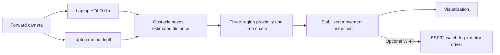
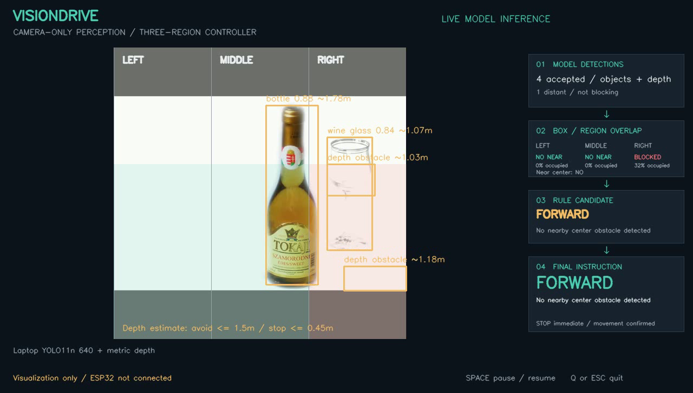

<div align="center">

# VisionDrive

**Forward-camera obstacle avoidance: laptop vision, explainable steering, ESP32 commands.**


[Run the demo](docs/laptop-esp32.md) · [Demo notebook](notebooks/laptop_esp32_demo.ipynb) · [ESP32 receiver](firmware/visiondrive_receiver/visiondrive_receiver.ino)

</div>

The camera represents the vehicle's forward view. VisionDrive detects objects
and nearby surfaces, checks **left, middle, and right** regions, and suggests
**FORWARD, LEFT, RIGHT, or STOP**. The laptop runs the neural networks. An
optional Wi-Fi link sends expiring movement commands to an ESP32 motor controller.

The visualization works without a board. Physical driving, distance calibration,
and avoidance accuracy remain unvalidated on a real course.

## Group members

- Sean Xander Aquino
- Blessie Faith Bongalos
- Joshua Jericho Barja
- John Renzzo Montenegro
- John Carlo Nas
- Divino Al Ricafort

## Assigned group project specialization

**Computer Vision–Based Obstacle Detection and Avoidance** is the working
specialization title. Replace this wording if the officially assigned title differs.

## Project description and system overview

The midterm asks: **“Can the System SEE and RECOGNIZE?”** VisionDrive answers
this with camera capture, image preprocessing, an annotated dataset with separate
training/validation/testing sets, a trained baseline detector, and a working
pretrained object-plus-depth interpretation demo. The movement overlay explains
how recognized objects and nearby surfaces influence a proposed vehicle action.
The motor receiver supports later integration; a physical car is not required
to demonstrate the midterm vision pipeline.

The [midterm report](docs/midterm-report.md) maps the rubric to actual artifacts,
explains unseen-situation testing, and identifies unfinished validation.

## System architecture and workflow



YOLO recognizes its 80 pretrained COCO categories. The depth path can flag
nearby, unnamed surfaces, including potential walls or unfamiliar shapes. A
ground-plane heuristic rejects visible flat floor. This provides broader
obstacle cues than the earlier bottle/cup/box-only detector. **It cannot
guarantee detection of every obstacle or certify that a route is clear.**

| What the vehicle sees | Suggested behavior |
| --- | --- |
| Only distant center obstacles | Continue forward |
| Nearby center obstacle | Turn toward a usable side |
| Both sides usable | Choose the side with less occupied image area |
| Center at emergency distance, or no usable side | Stop |
| Stale/invalid input, pause, or lost command updates | Stop |

Defaults start avoidance at **estimated 1.5 m** and emergency center stopping
at **estimated 0.45 m**. These are tunable demo thresholds, not calibrated
measurements. Three matching processed observations confirm movement. A newly
blocked center stops forward movement while a turn is being confirmed.

## Installation and setup instructions

```powershell
python -m venv .venv-inference
.venv-inference\Scripts\python -m pip install -r requirements-laptop.txt
.venv-inference\Scripts\python scripts/setup_laptop_models.py
.\run_logic_demo.cmd
```

On the already prepared development computer, just run `run_logic_demo.cmd`.
Setup downloads approximately 105 MB; inference uses local files. The viewer
shows **detections and estimated distances → blocked regions → rule candidate
→ final instruction**. Space pauses; Q/Escape quits.

```powershell
# Video demonstration without hardware:
.\run_logic_demo.cmd --source path/to/video.mp4
# Tune thresholds after comparing estimates with measured distances:
.\run_logic_demo.cmd --avoid-distance 1.5 --stop-distance 0.45
# Optional ESP32 connection after configuring/flashing the receiver:
$env:VISIONDRIVE_ESP_TOKEN = "your_shared_32_character_hex_token"
.\run_logic_demo.cmd --source 0 --esp-host 192.168.1.50
```

The board needs no neural-network runtime. It accepts valid, sequenced commands
after a STOP handshake and stops when commands expire. The receiver defaults
to **motor output disabled** until actual board/driver pins are configured.
See the [complete setup and calibration guide](docs/laptop-esp32.md).

## Instructions for running the system

Run `run_logic_demo.cmd` for a live camera, add `--source path/to/video.mp4` for
a recording, or use `--esp-host IP` after configuring the board. Space pauses;
Q/Escape exits. With no board address, the program only visualizes instructions.

For a synthetic controller presentation without ML dependencies:

```powershell
python -m pip install -r requirements.txt
python logic_demo.py --simulate
```

Simulation is explicitly labeled and cannot send commands to the ESP32.

## Hardware used

| Hardware | Actual use / status |
| --- | --- |
| Development laptop | Runs the implemented vision system; CPU inference tested |
| Recorded camera images/video | Used for actual inference and integration checks |
| Forward-facing webcam or vehicle camera | Live input supported; independent live-course testing pending |
| ESP32 board, motor driver, motors, chassis, power supply | Planned motor-control hardware; receiver firmware provided, no board connected or tested |

The current architecture does not require an ESP32 camera module or onboard ML.
A moving prototype needs a rigid forward camera and a live video path to the laptop.

## Software and tools used

| Tool | Role |
| --- | --- |
| Python 3.10+; tested with 3.13.5 | Application, data preparation, training, evaluation |
| OpenCV and NumPy | Capture, image processing, region geometry, overlays |
| PyTorch, torchvision, Ultralytics | YOLO and original ESPDet training/inference |
| Hugging Face Transformers / safetensors | Indoor metric-depth inference |
| Jupyter notebooks | Training and staged demonstration |
| Arduino-ESP32, Wi-Fi UDP | Receiver firmware and expiring motor instructions |
| pytest, native C++ compiler, GitHub Actions | Controller, depth, communication, and watchdog checks |

## Computer vision methodology

1. Capture an unmirrored forward frame and retain its capture timestamp.
2. Letterbox/resize for YOLO; normalize and convert image channels for depth.
3. Run object detection and metric-depth estimation on the laptop.
4. Restore boxes to original-image coordinates and estimate object proximity.
5. Remove matching flat-floor depth pixels; extract nearby connected surfaces.
6. Ignore distant obstacles for steering, calculate region occupancy, and apply
   the approach/emergency rules.
7. Confirm movement across fresh observations, display the explanation, and
   optionally send an expiring command to the ESP32.

## Dataset overview

The group's prepared **baseline dataset** contains 402 public Open Images images
and 688 labeled bottle/cup/box instances. Bounding boxes are normalized to YOLO
format. Content hashes are unique across splits, with source URLs, authors,
licenses, labels, and split assignments retained in the
[published manifest](data/public/bottle-cup-box-manifest.jsonl).

| Project split | Images | Approximate distribution | Purpose |
| --- | ---: | ---: | --- |
| Training | 280 | 70% | Fit the original ESPDet baseline |
| Validation | 60 | 15% | Select checkpoint and confidence threshold |
| Testing | 62 | 15% | Evaluate the original selected model |

These are project partitions from Open Images' validation source, not official
benchmark splits. The current laptop models use upstream pretrained COCO and
Hypersim weights; they were not trained on this 402-image group dataset.

**Unseen situations:** hold out entire new recording sessions/locations and new
physical object instances, varying lighting, distance, angle, background, and
obstacle combinations. Do not distribute adjacent frames of one clip across
splits. Our existing image-hash separation does not establish scene separation
or independence from upstream pretraining. New course recordings and manual
annotation review remain necessary. See the
[dataset card and reconstruction instructions](data/public/README.md).

## Model and algorithm used

| Model / algorithm | Role and scope |
| --- | --- |
| YOLO11n, 640×640 | Current pretrained 80-category object detector on the laptop |
| Depth Anything V2 Metric Indoor Small | Current category-independent proximity cues; estimated meters |
| Ground-plane fitting and connected components | Reduce floor responses and form nearby-surface obstacles |
| Three-region controller and temporal confirmation | Explainable forward/left/right/stop suggestions |
| ESPDet-Pico, 224×224 | Original group-trained three-class baseline; retained for comparison |

No claim of universal obstacle detection or reliable metric range is made.

## Project components

| Component | Location / status |
| --- | --- |
| Object and depth inference | [Laptop detector](visiondrive/laptop_detector.py), [depth processing](visiondrive/depth.py) |
| Movement rules | [Decision controller](visiondrive/decision.py) |
| Camera/video and instruction display | [Application](demo.py), [logic viewer](logic_demo.py) |
| Wi-Fi sender | [UDP link](visiondrive/esp_link.py) |
| ESP32 receiver and watchdog | [Arduino sketch](firmware/visiondrive_receiver/visiondrive_receiver.ino); physical validation outstanding |
| Model walkthrough | [Laptop/ESP32 notebook](notebooks/laptop_esp32_demo.ipynb) |
| Original tiny-model research | [Training notebook](notebooks/train_bottle_cup_box.ipynb), [three-class report](docs/model-report.md) |
| Validation | [Verification report](docs/verification.md) |

## Original ESP32 onboard experiment

The earlier **ESPDet-Pico, 224×224, bottle/cup/box** checkpoint remains included
with provenance and its upstream license. Its small held-out test showed weak
box recall (15%). It is retained for comparison and future onboard work:

```powershell
.venv-inference\Scripts\python scripts/setup_model.py --source-only
.\run_logic_demo.cmd --detector esp
```

That backend uses camera-specific image-position proximity, not depth in meters.
The [training notebook](notebooks/train_bottle_cup_box.ipynb) reproduces that
experiment. The current default is the stronger laptop hybrid. Running the
current hybrid entirely on an ESP32 is not implemented or claimed.

## Evaluation and limits

This is a reactive indoor prototype. Estimated depth can be wrong, especially
for transparent/reflective objects, thin structures, unfamiliar camera heights,
occlusion, poor lighting, and non-flat floors. Side image regions do not encode
vehicle width or turning arcs. Course testing must measure missed obstacles,
false stops, distance error, latency, and physical stopping distance before
making an avoidance-accuracy claim. Broader coverage is not a measured accuracy
percentage.

Test results and actual model integration checks are recorded in the
[verification report](docs/verification.md). CI also exercises the portable
ESP32 command parser/watchdog in native C++; it does not flash hardware.

## Sample results



Actual inference on a public test image; boxes/labels and distances are model
predictions, not ground-truth guarantees. Source attribution and the exact
record are in [sample results](docs/sample-results.md). This image is an
integration example, not a live vehicle trial.

The original group-trained baseline achieved **mAP@0.5 = 0.469** on 62 project
test images. Bottle recall was 0.442, cup recall 0.760, and box recall 0.154 at
confidence 0.35. These results belong to ESPDet, **not** the newer hybrid system.
See [the measured report](docs/model-report.md) and
[current integration checks](docs/verification.md).

## Required project materials

- [Midterm report and requirement mapping](docs/midterm-report.md)
- [Dataset card](data/public/README.md) and [fixed split/annotation manifest](data/public/bottle-cup-box-manifest.jsonl)
- [Original training notebook](notebooks/train_bottle_cup_box.ipynb) and [current model walkthrough](notebooks/laptop_esp32_demo.ipynb)
- [Baseline evaluation](docs/model-report.md), [machine-readable metrics](docs/model-evaluation.json), and [training curves data](docs/training-results.csv)
- [Sample results and attribution](docs/sample-results.md)
- [Installation, running, and Wi-Fi guide](docs/laptop-esp32.md)
- [Hardware handoff](docs/hardware-implementation.md) and [ESP32 receiver](firmware/visiondrive_receiver/visiondrive_receiver.ino)

Presentation slides and a separate submitted demo-video link have not been supplied.

## Attribution

Object detection uses [Ultralytics YOLO11](https://docs.ultralytics.com/models/yolo11/).
Depth uses [Depth Anything V2 Metric Indoor Small](https://huggingface.co/depth-anything/Depth-Anything-V2-Metric-Indoor-Small-hf).
The compact model uses [Espressif ESP-Detection](https://github.com/espressif/esp-detection).
Upstream models and libraries retain their licenses; see
[third-party notices](THIRD_PARTY_NOTICES.md). Downloaded large weights,
environments, source datasets, recordings, and Wi-Fi credentials stay outside Git.
