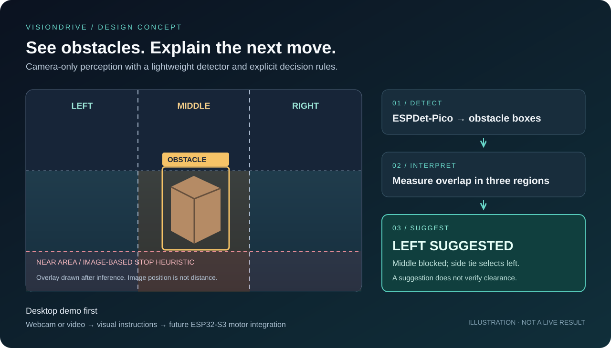
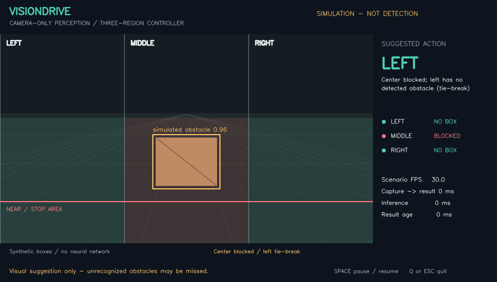
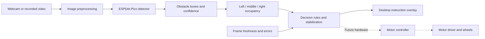

<div align="center">

# VisionDrive ESP32

**A camera-only mini-car concept: detect obstacles, interpret three regions, suggest movement.**


[Run the demo](docs/running-the-demo.md) · [Architecture](#architecture) · [Desktop specification](docs/implementation-plan.md) · [Hardware implementation guide](docs/hardware-implementation.md)

</div>



*Concept illustration, not a screenshot or inference result.*

## The concept

VisionDrive explores how a small robot car could use a camera to recognize obstacles and choose a movement suggestion. A lightweight detector identifies objects in an image. A separate controller examines **left, middle, and right regions** and produces **forward, left, right, or stop** suggestions.

The first milestone is a computer-based demonstration using a webcam or recorded video. A future version will run on an ESP32-S3 and translate the same decisions into wheel commands. The camera is the sole source of autonomous environmental perception; there is no planned ultrasonic, ToF, or LiDAR dependency.

This is an educational prototype for a flat, controlled indoor environment. It explores reactive obstacle avoidance, not destination navigation or road driving.

## Project status

**The desktop application and model/data tooling are implemented.** You can run the three-region controller immediately in an explicitly labeled simulation. Real webcam/video inference uses an ESPDet-Pico checkpoint. The upstream cat model can be smoke-tested; a bottle/cup/box obstacle checkpoint still requires training. Firmware and physical-car trials remain future work.

| Component | Current state |
| --- | --- |
| System architecture and decision specification | Documented |
| Desktop implementation and evaluation plan | Documented |
| Hardware implementation guide | Documented |
| Webcam/video detection application and ESPDet adapter | Implemented; trained obstacle checkpoint required |
| Labeled simulation and recording | Implemented; works without ML dependencies |
| Pure decision tests and lightweight CI | Implemented |
| Dataset conversion and training/evaluation tools | Implemented |
| Bottle, cup, and box training dataset | Planned |
| Fine-tuned ESPDet-Pico obstacle model | Planned |
| Measured accuracy, latency, and FPS | Not measured |
| ESP32-S3 firmware and physical-car trials | Planned; hardware not selected |



*Actual application render in simulation mode. Boxes are synthetic; this is not a neural-detection result.*

## Architecture



The model answers **where recognized obstacles are**. The controller determines **what movement to suggest**. Keeping these responsibilities separate makes the decisions explainable and allows the model to change without rewriting the movement rules.

## Three-region reasoning

Two vertical dividers create three equal image regions. Only the lower 60% of the frame participates in region occupancy. The bottom 20% is the initial **near-stop area**. These are configurable demonstration thresholds, not calibrated distance estimates.

An accepted obstacle box can block more than one region. A region is blocked when its decision-area intersection covers at least 10% of that obstacle's full box area. This avoids assigning a wide obstacle solely by its center point.

| Priority | Visual condition | Suggested instruction |
| --- | --- | --- |
| 1 | Camera/inference failure or stale result | **STOP — input unavailable** |
| 2 | Middle-blocking obstacle reaches the near area | **STOP — near obstacle** |
| 3 | Middle region has no accepted obstacle overlap | **FORWARD SUGGESTED** |
| 4 | Middle blocked; left unblocked and right blocked | **LEFT SUGGESTED** |
| 5 | Middle blocked; right unblocked and left blocked | **RIGHT SUGGESTED** |
| 6 | Middle blocked; both sides unblocked | **LEFT SUGGESTED** — deterministic demo tie-break |
| 7 | All regions blocked | **STOP — blocked** |

Movement suggestions require three consecutive matching processed frames. STOP applies immediately. Start, pause, and video completion leave the decision output stopped.

**An unblocked region means fewer detected obstacles, not a verified drivable route.** A missed object, wall, or table edge can remain invisible to this logic. The desktop overlay must retain that distinction.

## What can the current model detect?

The installed pretrained checkpoint recognizes **cats only**. The controller treats an accepted cat bounding box as an obstacle and applies the same region rules. Simulation boxes do not expand the model's supported classes.

| Object | Supported by the installed checkpoint? |
| --- | --- |
| Cats | Yes |
| Bottles, cups, and boxes | No; these are the planned fine-tuning targets |
| People, chairs, walls, and other everyday obstacles | No; not trained classes in this checkpoint |

Misses and false positives are still possible. No detection does not establish that a path is clear. Recognizing additional object types requires a suitable model or fine-tuning; changing the movement rules alone will not add recognition classes.

## Why ESPDet-Pico?

[ESP-Detection](https://github.com/espressif/esp-detection) provides an Espressif-oriented detection architecture, custom model components, and an export/deployment path through ESP-DL. Choosing it early keeps the desktop experiment connected to the intended hardware target.

The plan uses **224 × 224 input** and transfer learning from the repository's published ESPDet-Pico checkpoint. Its documented cat checkpoint is an initialization source, not an already trained bottle/cup/box detector. Fine-tuning and independent evaluation are required.

| Responsibility | Planned technology |
| --- | --- |
| Training and desktop inference | ESP-Detection adapter, PyTorch, compatible Ultralytics dependency |
| Camera capture, overlays, video playback | OpenCV |
| Region reasoning and instruction logic | Independent Python module |
| Desktop environment | Python 3.10+; tested on Windows / Python 3.13.5 |
| Future export and quantization | ONNX and Espressif quantization tools |
| Future onboard inference | ESP-DL with ESP-IDF on ESP32-S3 |

The setup script records a pinned upstream commit and checkpoint hash. No generic YOLO replacement is implied by using the Ultralytics API. Model-environment verification is documented in the [verification report](docs/verification.md).

## Data and training approach

The first model will merge **bottles, cups, and boxes** into one class, `obstacle`. The demo does not need to distinguish their names to evaluate blocked regions.

1. Audit [Open Images](https://storage.googleapis.com/openimages/web/download_v7.html) class availability and annotation quality.
2. Prepare a bounded public-image subset targeting 1,500 training, 300 validation, and 300 test images, with each object type represented.
3. Convert annotations to YOLO detection format, retain image provenance, and inspect missing or invalid boxes. Public box images require manual labeling if suitable annotations are unavailable.
4. Fine-tune ESPDet-Pico, saving the best validation checkpoint.
5. Evaluate on held-out public images and independent staged webcam/video scenes.

Background-only images need a label audit; an empty annotation file must not hide an unlabeled target object. The public subset is a starting point, not proof of performance in the presentation environment.

## Getting started

Start the controller preview without installing PyTorch:

```powershell
python -m venv .venv
.venv\Scripts\python -m pip install -r requirements.txt
.venv\Scripts\python demo.py --simulate
```

This cycles through eight synthetic scenes with region highlights and FORWARD/LEFT/RIGHT/STOP suggestions. Press Space to pause and Q/Escape to quit. For actual detection, follow [setup, training, and inference instructions](docs/running-the-demo.md).

Project guides:

- [Desktop implementation plan](docs/implementation-plan.md): application behavior, environment, dataset preparation, training, interfaces, and acceptance tests.
- [Run the demo](docs/running-the-demo.md): executable commands, model setup, public-data preparation, training, recording, and troubleshooting.
- [Hardware implementation guide](docs/hardware-implementation.md): parts selection, wiring preparation, model export, firmware responsibilities, calibration, and bring-up.
- [Third-party notices](THIRD_PARTY_NOTICES.md): references, provenance requirements, and upstream licenses.

### Visualize how the model produces an instruction

On Windows, the launcher selects the local model environment and starts the actual pretrained-model viewer:

```powershell
.\run_logic_demo.cmd
```

Or use a configured model environment directly:

```powershell
.venv-model\Scripts\python logic_demo.py
```

This program uses **actual model inference**, then displays the chain **detections → blocked regions → rule candidate → final instruction** next to the camera image. It defaults explicitly to the upstream cat checkpoint downloaded during model setup; its scope is labeled on screen. Use `--source path/to/video.mp4` for a recording, or `--weights path/to/best.pt --expected-label obstacle` for your trained obstacle model. On the current development computer, use the already prepared `.venv-inference\Scripts\python` interpreter instead.

The visualization shares the existing controller, including its three-observation confirmation and immediate STOP behavior. It has no physical robot drawing or hardware connection. See [the run guide](docs/running-the-demo.md#model-to-instruction-visualization) for examples.

### Application interface

Actual detection requires the model environment and a trained single-class `obstacle` checkpoint. The default weights location is `weights/obstacle/best.pt`:

```text
python demo.py --source 0
python demo.py --source path/to/video.mp4
python demo.py --source 0 --weights path/to/best.pt --config path/to/config.json
python demo.py --source path/to/video.mp4 --save-video path/to/annotated.mp4
```

The window shows detections, confidence, region occupancy, instruction and reason, processed FPS, and latency. Space pauses playback; Q or Escape exits. No model download occurs during inference. Optional recording creates an annotated MP4 plus a JSONL decision/timestamp log.

## Evaluation

| Measure | Status / intended evidence |
| --- | --- |
| Detection precision, recall, mAP@0.5, mAP@0.5:0.95 | Not measured; report on held-out data |
| Recall for bottles, cups, and boxes | Not measured; retain original object-type metadata |
| Instruction correctness | Automated synthetic rule/worker tests; see verification report |
| Desktop throughput | Not measured; target at least 10 processed FPS on the development laptop |
| Capture-to-decision latency | Not measured; report distribution and test conditions |
| Quantized-model accuracy | Not measured; compare with desktop predictions before deployment |
| ESP32-S3 memory, latency, and stopping performance | Not measured; requires selected hardware |

Published upstream benchmarks describe upstream models and equipment. They are not VisionDrive results and do not establish this project's end-to-end speed.

## Roadmap

- [x] Document the camera-only architecture and decision rules.
- [x] Prepare the desktop and hardware implementation guides.
- [x] Implement model-independent decision logic and tests.
- [x] Add explicit simulation, recording, and headless verification.
- [x] Add webcam/video inference adapter and presentation overlay.
- [x] Add provenance-aware dataset conversion and training tools.
- [ ] Prepare the public dataset and fine-tune ESPDet-Pico.
- [ ] Publish an annotated demo recording and measured evaluation.
- [ ] Select the hardware and validate INT8 export.
- [ ] Port decision logic and implement bounded motor control.
- [ ] Complete supervised low-speed trials on a controlled course.

## Limitations and design tradeoffs

- **Recognition is limited by training data.** Unknown objects and unusual views may be missed.
- **Image coordinates are not meters.** A lower bounding-box edge can indicate approach only under restricted camera and surface assumptions.
- **Three regions simplify geometry.** They do not represent the car's complete swept path through a turn.
- **Camera-only perception depends on visibility.** Blur, shadows, glare, low light, and occlusion affect results.
- **Reactive avoidance has no destination model.** Route following, mapping, and floor-boundary recognition require additional work.
- **Desktop success does not imply embedded feasibility.** Supported operators, activation memory, quantization quality, and capture-to-command delay must be measured onboard.

## Contributions and attribution

VisionDrive's contribution is the proposed integration: a three-region controller, explainable instruction display, evaluation workflow, and a documented path from desktop to embedded implementation. ESPDet-Pico and its training/deployment components originate with Espressif and their respective upstream contributors.

No third-party source code, model weights, or dataset images are bundled in Git. Setup places the upstream checkout and weights in ignored directories. See [THIRD_PARTY_NOTICES.md](THIRD_PARTY_NOTICES.md) before redistributing them. A project-wide redistribution license has not been selected; upstream components retain their own licenses.

## References

- [Espressif ESP-Detection](https://github.com/espressif/esp-detection)
- [Espressif ESP-DL](https://github.com/espressif/esp-dl)
- [ESP-IDF documentation for ESP32-S3](https://docs.espressif.com/projects/esp-idf/en/stable/esp32s3/)
- [Open Images dataset and download documentation](https://storage.googleapis.com/openimages/web/download_v7.html)
- [Ultralytics detection dataset format](https://docs.ultralytics.com/datasets/detect/)

---

**Current milestone:** desktop prototype with an explainable controller and ESPDet integration. Training the obstacle checkpoint, measuring presentation performance, and physical-car validation remain future milestones.
