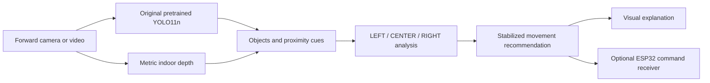

# VisionDrive

**Camera-based obstacle interpretation: laptop vision, visible movement logic and an optional ESP32 controller.**

[Executable evaluation notebook](notebooks/yolo11n_pretrained_evaluation.ipynb) · [Measured results](docs/evaluation_results.md) · [Run the demo](docs/laptop-esp32.md) · [Project materials](docs/README.md)

VisionDrive treats the camera as the vehicle's forward view. Original pretrained YOLO11n recognizes objects; Depth Anything V2 Metric Indoor Small estimates nearby surfaces. A three-region controller displays **FORWARD, LEFT, RIGHT or STOP**. An optional ESP32 receives expiring commands over Wi-Fi. The laptop runs the neural networks; a board is unnecessary for the visual demo.

This academic prototype does not guarantee recognition of every obstacle, calibrated distance, a clear route or safe physical driving.

## Group members and specialization

Sean Xander Aquino · Blessie Faith Bongalos · Joshua Jericho Barja · John Renzzo Montenegro · John Carlo Nas · Divino Al Ricafort

Working specialization: **Computer Vision–Based Obstacle Detection and Avoidance**. The group must confirm its officially assigned wording.

## System overview and computer vision methodology



The detector keeps its original **80 COCO classes**. The separate depth pathway contributes unnamed surfaces, including potential walls or generic boxes. Ground-plane rejection and estimated-distance thresholds require camera-specific validation. Nearby center obstacles prompt a usable side turn; distant obstacles need not stop movement. Emergency clearance, blocked regions, invalid/stale observations and command timeouts preserve STOP behavior.

## Hardware and software

| Component | Current role |
| --- | --- |
| Laptop and USB/integrated camera | Perception and visualization |
| RTX 3050 6 GB Laptop GPU | Actual CUDA evaluation hardware; CPU also supported |
| ESP32, motor driver, motors, vehicle camera | Optional future physical integration; no board trial claimed |
| Python, PyTorch, torchvision, Ultralytics | Original YOLO11n inference and evaluation |
| Transformers, OpenCV, NumPy | Depth, camera capture and image processing |
| Pandas, Matplotlib, Jupyter | Reproducible tables, graphs and research notebook |

## Installation and quick start — Windows PowerShell

Run from the repository root. Python 3.11–3.13 is recommended; the recorded local evaluation used Python 3.13.5. GPU wheels require a compatible NVIDIA driver.

```powershell
python -m venv .venv-evaluation
.venv-evaluation\Scripts\python -m pip install -r requirements-evaluation-gpu.txt
.venv-evaluation\Scripts\python scripts/setup_laptop_models.py
.venv-evaluation\Scripts\python logic_demo.py --device 0
```

For CPU use, install `requirements-evaluation.txt` instead, add `requirements-laptop.txt` for the depth demo, and use `--device cpu`. Keep CPU and GPU package sets in separate environments. Setup explicitly downloads and checks model files; inference never silently downloads replacements.

```powershell
# Saved footage, visualization only.
.venv-evaluation\Scripts\python logic_demo.py --device 0 --source path/to/video.mp4
# Object-only view.
.venv-evaluation\Scripts\python logic_demo.py --device 0 --detector coco
```

See the [run guide](docs/laptop-esp32.md) for recording, OBS capture, calibration and ESP32 commands. `--simulate` is explicitly synthetic and cannot issue motor commands.

## Dataset overview and evaluation

The current experiment evaluates **unchanged pretrained YOLO11n**, with no training or fine-tuning. Its fresh indoor cohort contains **400 photos: 80 development / 320 test**, with **923 person annotations**. Every image has human-verified person presence or absence. Each split is 75% person-positive / 25% verified negative; every photograph has a different photographer. Previously inspected and baseline images are excluded. The protocol and hashes were frozen in commit `8a6f52a` before fresh-cohort inference.

**Only person (original COCO ID 0) is primary-scored.** Pilot chair scoring was excluded because Open Images separates Stool and does not provide complete coverage for the COCO chair concept. All 80 detector categories remain available in the live application. The [taxonomy audit](docs/taxonomy-audit.md) explains this limit; the old pilot remains exploratory.

Photos come from Open Images with per-image authors and CC BY 2.0 attribution; annotations are CC BY 4.0. Original source splits, photographer separation, checksums, label validation and duplicate checks are recorded. The cohort meets the 300–500-image planning target while retaining strict annotation checks.

[Dataset card and candidate comparison](docs/dataset_card.md) · [Frozen manifest](data/public/indoor-evaluation-manifest.jsonl) · [Annotation QA exclusions](data/public/indoor-annotation-review.json)

```powershell
.venv-evaluation\Scripts\python scripts/download_dataset.py
.venv-evaluation\Scripts\python scripts/validate_annotations.py
.venv-evaluation\Scripts\python scripts/evaluate_pretrained.py --device 0
```

Download restores exactly the frozen manifest and verifies image hashes. No API key is required for this cohort. Raw images and generated local outputs stay outside Git.

## Notebook and graphs

```powershell
.venv-evaluation\Scripts\python -m ipykernel install --user --name visiondrive-evaluation --display-name "Python (VisionDrive evaluation)"
.venv-evaluation\Scripts\python -m jupyter lab notebooks/yolo11n_pretrained_evaluation.ipynb
```

Select **Python (VisionDrive evaluation)** and **Run All**. Set `DEVICE='cpu'` in Section 2 for an intentional CPU run. The notebook has 12 labeled sections: objective, environment, acquisition, exploration, original checkpoint, native evaluation, metrics, class results, plots, timing, errors and interpretation. It never invokes training.

Outputs in `outputs/evaluation/yolo11n/`: metrics JSON, CSV tables, provenance, validation, environment, configuration, raw/normalized confusion matrices, PR/F1 curves, distribution, per-class AP, attributed prediction examples and generated report. Compact submission copies live in `docs/results/yolo11n/` and `assets/evaluation/`.

## Sample results and interpretation

| Metric | Measured on 320 fresh indoor test images |
| --- | ---: |
| Micro precision at confidence .35 | 79.19% |
| Micro recall at confidence .35 | 63.93% |
| Micro F1 at confidence .35 | 70.75% |
| mAP@50 | 72.12% |
| mAP@75 | 54.02% |
| mAP@50–95 | 50.94% |

These are person-only **object-detection** measurements (mAP equals AP for this single scored class), not classification accuracy or obstacle-avoidance success. Misses remain substantial. Read the [full results](docs/evaluation_results.md) for counts, confidence intervals, GPU latency and failure examples. Published COCO benchmark values are external references.


## Midterm evidence and limitations

The [midterm report](docs/midterm-report.md) maps **“Can the System SEE and RECOGNIZE?”** to the demo and research artifacts. The earlier ESPDet-Pico experiment retains its **402-image training/validation/test dataset**, checkpoint, [training curves](assets/baseline-training-curves.png) and measured results. It is separate from unchanged YOLO evaluation.

Public interior photos are not recordings from our car. Duplicate and photographer checks cannot prove physical scene independence or absence from COCO pretraining. Only person is validly primary-scored. The earlier two-class result is exploratory because of the chair/stool taxonomy defect. Independent camera testing, calibrated depth and physical driving remain separate work. See the [future camera protocol](docs/camera-evaluation.md).

## Required materials and citations

- [Methodology](docs/evaluation_methodology.md), [dataset card](docs/dataset_card.md), [research report](docs/evaluation_results.md).
- [Paper guide](docs/documentation-and-paper-guide.md), [current presentation script](docs/current-presentation-script.md), [historical ESP paper section](docs/paper-dataset-and-training.md).
- [Hardware handoff](docs/hardware-implementation.md), [verification](docs/verification.md), [cleanup ledger](docs/repository-inventory.md).
- [Ultralytics YOLO11](https://docs.ultralytics.com/models/yolo11/), [Depth Anything V2](https://github.com/DepthAnything/Depth-Anything-V2), [ESP-Detection](https://github.com/espressif/esp-detection).
- [Open Images protocol](https://storage.googleapis.com/openimages/web/factsfigures_v7.html), [download specification](https://storage.googleapis.com/openimages/web/download_v7.html), [Open Images paper](https://arxiv.org/abs/1811.00982).

Licensing and image attribution are in [third-party notices](THIRD_PARTY_NOTICES.md) and the manifests. No project-wide redistribution license is implied.
