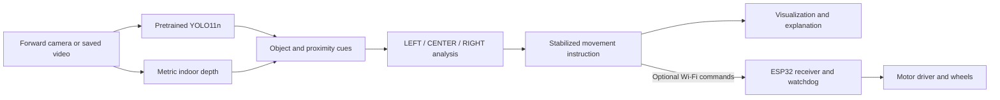
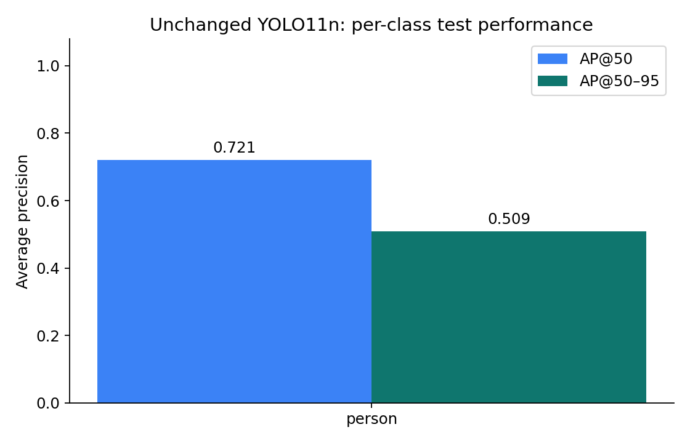
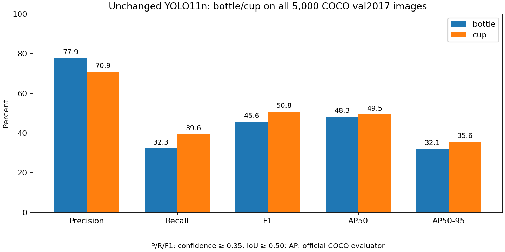

# VisionDrive

**Computer Vision–Based Obstacle Detection and Avoidance**

A forward-camera prototype that combines object detection, estimated depth and
three-region logic to display **FORWARD, LEFT, RIGHT or STOP**. Perception runs on
a laptop; an optional ESP32 receives expiring movement commands.

[Run the demo](#installation-and-setup) ·
[Evaluation notebook](notebooks/yolo11n_pretrained_evaluation.ipynb) ·
[Measured results](docs/evaluation_results.md) ·
[Dataset and sources](docs/dataset_card.md) ·
[Project materials](#required-project-materials)


*Actual application output. Image credits and modifications are documented in
[sample results](THIRD_PARTY_NOTICES.md#application-screenshot-attribution). This screenshot is separate from the
fresh evaluation study.*

## Project description

VisionDrive treats the camera as the vehicle's forward view. **Original pretrained
YOLO11n** identifies objects, while **Depth Anything V2 Metric Indoor Small**
estimates surface depth. The application examines the left, center and right
regions, then explains the resulting movement recommendation.

The visualization works without an ESP32 or physical car. It is a working academic
prototype; calibrated distance, independent vehicle-camera performance and
physical collision avoidance remain unvalidated.

## Group members

- Sean Xander Aquino
- Blessie Faith Bongalos
- Joshua Jericho Barja
- John Renzzo Montenegro
- John Carlo Nas
- Divino Al Ricafort

## Assigned group project specialization

**Computer Vision–Based Obstacle Detection and Avoidance** is the working
specialization title. The group must confirm the officially assigned wording.

## System overview and workflow



| Observation | Intended controller response |
| --- | --- |
| No nearby center obstacle | Continue forward after confirmation |
| Nearby center obstacle, usable side | Turn toward a usable side |
| Distant object | Keep it visible without automatically blocking movement |
| Emergency center clearance or all regions blocked | STOP |
| Invalid/stale input or expired motor commands | STOP |

The controller requires fresh observations and confirmation before authorizing
movement. The visual-result hold and physical-command freshness are separate.
See [the run guide](docs/laptop-esp32.md) for the exact behavior and configuration.

## Hardware used

| Hardware | Role and status |
| --- | --- |
| Laptop and integrated/USB camera | Perception and visualization |
| NVIDIA RTX 3050 6 GB Laptop GPU | Hardware used for the recorded CUDA evaluation |
| ESP32 | Optional movement-command receiver; no physical board trial claimed |
| Motor driver, motors, chassis and vehicle-mounted camera | Future physical integration |

The laptop runs YOLO and depth estimation. The current implementation does not
run these networks on the ESP32. The [hardware handoff](docs/laptop-esp32.md#hardware-implementation)
covers later integration.

## Software and tools

| Tool | Purpose |
| --- | --- |
| Python, PyTorch and torchvision | Model execution and CUDA support |
| Ultralytics YOLO11n | Original COCO-pretrained object detector |
| Transformers and Depth Anything V2 | Metric indoor depth estimation |
| OpenCV and NumPy | Camera/video handling, image processing and geometry |
| Pandas and Matplotlib | Evaluation tables and diagnostic figures |
| Jupyter Notebook | Executable research workflow |
| pytest and native C++ checks | Software and firmware safeguard verification |

CPU and GPU dependency files are provided separately. The recorded evaluation
used Python 3.13.5; package versions are saved in
[environment.json](docs/results/yolo11n/environment.json).

## Computer vision methodology

1. Capture a forward-facing camera frame or decode saved video.
2. Run the original 80-class YOLO11n detector.
3. Estimate depth and extract nearby surface cues, including unnamed obstacles.
4. Reject likely floor using a ground-plane heuristic.
5. Analyze occupancy and estimated clearance in three image regions.
6. Stabilize the recommendation and display its reason.
7. Optionally send short-lived commands to the ESP32 receiver.

Walls and generic boxes are not standard COCO categories. They may contribute
through the depth pathway without a recognized name. Depth estimates and floor
rejection require camera-specific validation; detection of every obstacle is
not guaranteed.

## Dataset overview

The final pretrained evaluation uses **400 fresh real indoor photographs**
selected from Open Images.

| Partition | Images | Person-positive | Verified person-negative | Person annotations |
| --- | ---: | ---: | ---: | ---: |
| Development | 80 | 60 | 20 | 191 |
| Test | 320 | 240 | 80 | 732 |
| **Total** | **400** | **300** | **100** | **923** |

The cohort contains one image per photographer profile. Previously inspected
pilot and historical baseline image IDs are excluded. Source-only selection,
image hashes and evaluation settings were frozen in commit
[`8a6f52a`](https://github.com/thebaynal/Vision-Drive/commit/8a6f52a)
before inference on the fresh test set.

Photos retain individual **CC BY 2.0** attribution; Open Images annotations are
**CC BY 4.0**. The group selected and prepared these public images; it did not
photograph them.

**Only person, original COCO ID 0, is primary-scored.** Pilot chair evaluation was
excluded because Open Images separates Stool from Chair, leaving incomplete
coverage for the COCO chair concept. The live detector retains all 80 categories.

- [Dataset card and source comparison](docs/dataset_card.md)
- [Frozen annotations and individual attribution](data/public/indoor-evaluation-manifest.jsonl)
- [Selection audit and source checksums](data/public/indoor-selection-audit.json)
- [Chair/Stool taxonomy audit](docs/dataset_card.md#chair-stool-taxonomy)

The historical ESPDet-Pico experiment separately retains its **402-image
training/validation/test dataset**. The unchanged YOLO study uses development/test
partitions and introduces no unnecessary training workflow.

## Model and algorithm used

| Component | Configuration |
| --- | --- |
| Object detector | Original pretrained YOLO11n; no project fine-tuning |
| Depth estimator | Depth Anything V2 Metric Indoor Small |
| Navigation logic | Three-region proximity analysis and stateful confirmation |
| Primary evaluation | Fresh indoor person study, preserving the original 80-class model |
| Supplementary evaluation | Bottle and cup on all 5,000 COCO validation images |
| Historical baseline | Separately trained ESPDet-Pico bottle/cup/box detector |

Checkpoint hashes, class mappings, matching rules and uncertainty methods are
documented in the [evaluation methodology](docs/dataset_card.md#evaluation-methodology).
Historical ESP training records do not describe YOLO performance.

### Pretrained YOLO11n: origin and published metrics

**Ultralytics trained the original detector on COCO**, with 80 object categories.
We use its [official pretrained checkpoint](https://github.com/ultralytics/assets/releases/download/v8.3.0/yolo11n.pt)
without fine-tuning. Credit: **Jocher and Qiu (2024)**;
[formatted citation and BibTeX](#yolo11n-citation).

| Published YOLO11n benchmark | Value |
| --- | --- |
| Evaluation dataset | COCO val2017, 80 detection classes |
| Input size | 640 pixels |
| Bounding-box mAP50–95 | **39.5%** |
| CPU latency, ONNX | 56.1 ± 0.8 ms/image |
| NVIDIA T4 latency, TensorRT 10 | 1.5 ± 0.0 ms/image |
| Parameters, rounded | 2.6 million |
| Compute | 6.5 GFLOPs |

Source: [Ultralytics YOLO11 detection benchmark](https://docs.ultralytics.com/models/yolo11/#performance-metrics).
These are upstream results, not measurements made by our group. The cited
summary does not provide YOLO11n precision, recall, F1, AP50 or AP75; our
[local results](#sample-results) report those for the **person study** and the separate **bottle/cup benchmark**. Local
person AP and upstream 80-class mAP measure different tasks. ONNX/TensorRT
timings also use different runtimes and hardware from our PyTorch laptop run.

### Original training dataset and all 80 class counts

COCO means **Common Objects in Context**. Its photographs contain everyday
objects in varied scenes; detection annotations provide category labels,
bounding boxes and instance masks. The original source is the
[COCO dataset](https://cocodataset.org/#download), described by
[Lin et al. (2014)](https://arxiv.org/abs/1405.0312).
The [Ultralytics dataset configuration](https://github.com/ultralytics/ultralytics/blob/main/ultralytics/cfg/datasets/coco.yaml)
specifies `train2017` and `val2017` for COCO detection.

| Official COCO 2017 split | Images | Non-crowd object instances | Crowd-region records |
| --- | --- | --- | --- |
| Training (`train2017`) | 118,287 | 849,949 | 10,052 |
| Validation (`val2017`) | 5,000 | 36,335 | 446 |

The published benchmark uses validation images. COCO test-dev has 20,288
images with withheld ground truth; it is not the split behind the reported
39.5% validation mAP. See the [split specification](https://docs.ultralytics.com/datasets/detect/coco/#dataset-structure).
Our separate Open Images development/test cohort is described above.

Counts below were computed directly from the official
[`instances_train2017.json` and `instances_val2017.json` archive](http://images.cocodataset.org/annotations/annotations_trainval2017.zip).
**Images per class** counts distinct images containing that category, including
crowd annotations. A photo can contain several classes, so column sums exceed
the number of photos. **Instances** below excludes `iscrowd=1`: a crowd-region
annotation does not specify how many individual objects it contains.

Download the [complete counts CSV](data/public/coco2017-class-counts.csv),
including sparse COCO category IDs and separate crowd columns. The
[statistics JSON](data/public/coco2017-statistics.json) records annotation and
archive SHA-256 hashes. Counts describe the source dataset, not exact image
exposures after upstream filtering, augmentation or repeated epochs.

<details>
<summary>Show all 80 classes and their training/validation image and instance counts</summary>

| YOLO ID | Class | Train images | Train instances | Val images | Val instances |
| --- | --- | --- | --- | --- | --- |
| 0 | person | 64,115 | 257,253 | 2,693 | 10,777 |
| 1 | bicycle | 3,252 | 7,056 | 149 | 314 |
| 2 | car | 12,251 | 43,533 | 535 | 1,918 |
| 3 | motorcycle | 3,502 | 8,654 | 159 | 367 |
| 4 | airplane | 2,986 | 5,129 | 97 | 143 |
| 5 | bus | 3,952 | 6,061 | 189 | 283 |
| 6 | train | 3,588 | 4,570 | 157 | 190 |
| 7 | truck | 6,127 | 9,970 | 250 | 414 |
| 8 | boat | 3,025 | 10,576 | 121 | 424 |
| 9 | traffic light | 4,139 | 12,842 | 191 | 634 |
| 10 | fire hydrant | 1,711 | 1,865 | 86 | 101 |
| 11 | stop sign | 1,734 | 1,983 | 69 | 75 |
| 12 | parking meter | 705 | 1,283 | 37 | 60 |
| 13 | bench | 5,570 | 9,820 | 235 | 411 |
| 14 | bird | 3,237 | 10,542 | 125 | 427 |
| 15 | cat | 4,114 | 4,766 | 184 | 202 |
| 16 | dog | 4,385 | 5,500 | 177 | 218 |
| 17 | horse | 2,941 | 6,567 | 128 | 272 |
| 18 | sheep | 1,529 | 9,223 | 65 | 354 |
| 19 | cow | 1,968 | 8,014 | 87 | 372 |
| 20 | elephant | 2,143 | 5,484 | 89 | 252 |
| 21 | bear | 960 | 1,294 | 49 | 71 |
| 22 | zebra | 1,916 | 5,269 | 85 | 266 |
| 23 | giraffe | 2,546 | 5,128 | 101 | 232 |
| 24 | backpack | 5,528 | 8,714 | 228 | 371 |
| 25 | umbrella | 3,968 | 11,265 | 174 | 407 |
| 26 | handbag | 6,841 | 12,342 | 292 | 540 |
| 27 | tie | 3,810 | 6,448 | 145 | 252 |
| 28 | suitcase | 2,402 | 6,112 | 105 | 299 |
| 29 | frisbee | 2,184 | 2,681 | 84 | 115 |
| 30 | skis | 3,082 | 6,623 | 120 | 241 |
| 31 | snowboard | 1,654 | 2,681 | 49 | 69 |
| 32 | sports ball | 4,262 | 6,299 | 169 | 260 |
| 33 | kite | 2,261 | 8,802 | 91 | 327 |
| 34 | baseball bat | 2,506 | 3,273 | 97 | 145 |
| 35 | baseball glove | 2,629 | 3,747 | 100 | 148 |
| 36 | skateboard | 3,476 | 5,536 | 127 | 179 |
| 37 | surfboard | 3,486 | 6,095 | 149 | 267 |
| 38 | tennis racket | 3,394 | 4,807 | 167 | 225 |
| 39 | bottle | 8,501 | 24,070 | 379 | 1,013 |
| 40 | wine glass | 2,533 | 7,839 | 110 | 341 |
| 41 | cup | 9,189 | 20,574 | 390 | 895 |
| 42 | fork | 3,555 | 5,474 | 155 | 215 |
| 43 | knife | 4,326 | 7,760 | 181 | 325 |
| 44 | spoon | 3,529 | 6,159 | 153 | 253 |
| 45 | bowl | 7,111 | 14,323 | 314 | 623 |
| 46 | banana | 2,243 | 9,195 | 103 | 370 |
| 47 | apple | 1,586 | 5,776 | 76 | 236 |
| 48 | sandwich | 2,365 | 4,356 | 98 | 177 |
| 49 | orange | 1,699 | 6,302 | 85 | 285 |
| 50 | broccoli | 1,939 | 7,261 | 71 | 312 |
| 51 | carrot | 1,683 | 7,758 | 81 | 365 |
| 52 | hot dog | 1,222 | 2,884 | 51 | 125 |
| 53 | pizza | 3,166 | 5,807 | 153 | 284 |
| 54 | donut | 1,523 | 7,005 | 62 | 328 |
| 55 | cake | 2,925 | 6,296 | 124 | 310 |
| 56 | chair | 12,774 | 38,073 | 580 | 1,771 |
| 57 | couch | 4,423 | 5,779 | 195 | 261 |
| 58 | potted plant | 4,452 | 8,631 | 172 | 342 |
| 59 | bed | 3,682 | 4,192 | 149 | 163 |
| 60 | dining table | 11,837 | 15,695 | 501 | 695 |
| 61 | toilet | 3,353 | 4,149 | 149 | 179 |
| 62 | tv | 4,561 | 5,803 | 207 | 288 |
| 63 | laptop | 3,524 | 4,960 | 183 | 231 |
| 64 | mouse | 1,876 | 2,261 | 88 | 106 |
| 65 | remote | 3,076 | 5,700 | 145 | 283 |
| 66 | keyboard | 2,115 | 2,854 | 106 | 153 |
| 67 | cell phone | 4,803 | 6,422 | 214 | 262 |
| 68 | microwave | 1,547 | 1,672 | 54 | 55 |
| 69 | oven | 2,877 | 3,334 | 115 | 143 |
| 70 | toaster | 217 | 225 | 8 | 9 |
| 71 | sink | 4,678 | 5,609 | 187 | 225 |
| 72 | refrigerator | 2,360 | 2,634 | 101 | 126 |
| 73 | book | 5,332 | 24,077 | 230 | 1,129 |
| 74 | clock | 4,659 | 6,320 | 204 | 267 |
| 75 | vase | 3,593 | 6,577 | 137 | 274 |
| 76 | scissors | 947 | 1,464 | 28 | 36 |
| 77 | teddy bear | 2,140 | 4,729 | 94 | 190 |
| 78 | hair drier | 189 | 198 | 9 | 11 |
| 79 | toothbrush | 1,007 | 1,945 | 34 | 57 |

</details>

To reproduce the counts, download the annotation ZIP from COCO's official page
to `data/raw/coco2017/annotations_trainval2017.zip`, then run:

```powershell
python scripts/summarize_coco.py
```

The script uses only Python's standard library; it downloads no photos and
runs no training. The exact upstream training GPU, physical training location,
epoch-by-epoch history and checkpoint-specific training settings are not
established by the cited model summary. We do not present tutorial defaults
as the actual pretrained checkpoint's training log. Our downloaded checkpoint's
SHA-256 is `0ebbc80d4a7680d14987a577cd21342b65ecfd94632bd9a8da63ae6417644ee1`.
The training and evaluation descriptions above concern the YOLO detector;
Depth Anything V2 has separate provenance.

## Installation and setup

Run the following from the repository root in **Windows PowerShell**.

### NVIDIA GPU setup

```powershell
python -m venv .venv-evaluation
.venv-evaluation\Scripts\python -m pip install -r requirements-evaluation-gpu.txt
.venv-evaluation\Scripts\python scripts/setup_laptop_models.py
```

Use a compatible NVIDIA driver. The setup script explicitly downloads and checks
the model files; inference reads local checkpoints.

### CPU setup

Use a separate environment for CPU dependencies:

```powershell
python -m venv .venv-cpu
.venv-cpu\Scripts\python -m pip install -r requirements-evaluation.txt -r requirements-laptop.txt
.venv-cpu\Scripts\python scripts/setup_laptop_models.py
```

## Running the system

```powershell
# Live camera visualization with YOLO and depth.
.venv-evaluation\Scripts\python logic_demo.py --device 0

# Saved video, visualization only.
.venv-evaluation\Scripts\python logic_demo.py --device 0 --source path/to/video.mp4

# Object-only visualization.
.venv-evaluation\Scripts\python logic_demo.py --device 0 --detector coco

# CPU visualization.
.venv-cpu\Scripts\python logic_demo.py --device cpu
```

Without `--esp-host`, the application is visualization-only. The explicitly
synthetic `--simulate` mode illustrates logic and cannot issue motor commands.

See the [run guide](docs/laptop-esp32.md) for camera selection, recording, OBS
capture, calibration and ESP32 connection instructions.

## Reproducing the evaluation

### Download, validate and evaluate

```powershell
.venv-evaluation\Scripts\python scripts/download_dataset.py
.venv-evaluation\Scripts\python scripts/validate_annotations.py
.venv-evaluation\Scripts\python scripts/evaluate_pretrained.py --device 0
```

Acquisition restores the frozen manifest, verifies image hashes and reuses valid
cached data. No API key is required for this cohort. For CPU evaluation, use
`.venv-cpu\Scripts\python` and `--device cpu`.

### Reproduce the bottle/cup benchmark

Download `annotations_trainval2017.zip` and `val2017.zip` from
[COCO's official download page](https://cocodataset.org/#download) into
`data/raw/coco2017/`. Both evaluation requirements files include `pycocotools`.
With the GPU environment installed, run:

```powershell
.venv-evaluation\Scripts\python scripts/evaluate_coco_objects.py --stage prepare
.venv-evaluation\Scripts\python scripts/evaluate_coco_objects.py --stage evaluate --device 0
```

For CPU use the CPU environment and `--device cpu`. The executed notebook's
**Section 13** runs this experiment and displays the measured table and chart.
Raw predictions stay in `outputs/evaluation/coco-objects/`; published metrics and
hashes are in `docs/results/yolo11n-coco-objects/`.

### Run the notebook

```powershell
.venv-evaluation\Scripts\python -m ipykernel install --user --name visiondrive-evaluation --display-name "Python (VisionDrive evaluation)"
.venv-evaluation\Scripts\python -m jupyter lab notebooks/yolo11n_pretrained_evaluation.ipynb
```

Select **Python (VisionDrive evaluation)** and choose **Run All**.
For a CPU notebook run, register/select the CPU environment and set
`DEVICE='cpu'` in Section 2 and `objects_device='cpu'` in Section 13.

The notebook contains **13 labeled sections** covering the objective, environment,
acquisition, exploration, checkpoint verification, native evaluation, metrics,
class results, diagnostic plots, benchmarking, error analysis and interpretation.
All 12 code cells have saved successful executions, including the supplementary bottle/cup benchmark in Section 13.
**No YOLO training or fine-tuning occurs.**

### Locate the outputs

Local outputs are written to `outputs/evaluation/yolo11n/`:

- Metrics and class tables
- Dataset validation, source attribution, configuration and environment
- Raw/normalized detection matrices and PR/F1 curves
- Class distribution and AP charts
- Ground-truth review sheets, predictions, missed detections and false positives
- Automatically generated research report

Compact published evidence is in [docs/results/yolo11n](docs/results/yolo11n)
and [assets/evaluation](assets/evaluation). Raw images, downloaded laptop weights
and full local runs remain outside Git.

## Sample results

**Person detection on 320 fresh test images, containing 732 annotated people:**

| Metric | Measured result |
| --- | ---: |
| Precision at confidence .35 | **79.19%** |
| Recall at confidence .35 | **63.93%** |
| F1 at confidence .35 | **70.75%** |
| AP@50 | **72.12%** |
| AP@75 | **54.02%** |
| AP@50–95 | **50.94%** |
| True positives / false positives / false negatives | **468 / 123 / 264** |

Only one category is primary-scored, so mAP equals that category's AP. These are
object-localization metrics, not ordinary classification accuracy or physical
obstacle-avoidance success. Evaluation uses NMS IoU .70; the live application's
default is .45.



| Timing measurement | Mean latency | Throughput from mean |
| --- | ---: | ---: |
| YOLO network inference | 9.19 ms | 108.82 FPS |
| YOLO predict call, including preprocessing/postprocessing and Python overhead | 14.92 ms | 67.01 FPS |
| Separate serial decode + YOLO + depth + controller + explanation rendering | 109.34 ms | 9.15 FPS |

Timing was measured on the RTX 3050. The YOLO benchmark used 100 images after
10 warmups with CUDA synchronization; the hybrid measurement used 20 images.
These measurements exclude live camera capture, GUI display and motor execution.

Read the [full report](docs/evaluation_results.md) for confidence intervals,
condition breakdowns, attributed failure examples and experimental limitations.

### Bottle and cup detection: additional measured benchmark

We also ran the **same unchanged YOLO11n on all 5,000 COCO val2017 images**
using the RTX 3050. This includes 641 images with bottle and/or cup annotations
and 4,359 images containing neither, so false alarms are included. There was
**no training or fine-tuning**. The original 80-class detector is preserved.

| Object | Ground-truth instances | Precision | Recall | F1 | AP50 | AP75 | AP50–95 |
| --- | ---: | ---: | ---: | ---: | ---: | ---: | ---: |
| Bottle | 1,013 | 77.86% | 32.28% | 45.64% | 48.32% | 35.73% | 32.06% |
| Cup | 895 | 70.94% | 39.55% | 50.79% | 49.48% | 38.44% | 35.61% |

At confidence .35, the model misses **686 of 1,013 bottles** and **541 of 895
cups**. The recall values show that recognizing these classes does not mean
reliably detecting every object in view.

P/R/F1: confidence ≥ .35 and matching IoU ≥ .50. AP: official `pycocotools`
COCO bounding-box evaluation, IoUs .50:.05:.95, 101 recall points, all areas,
maxDets=100; 640×640 letterboxing, FP32, NMS .70 and AP confidence floor .001.
COCO crowd/ignore handling is retained. The instance counts exclude 12 bottle
and 4 cup crowd regions; these regions are handled by the evaluator.

**This is a known upstream COCO validation benchmark, not an independent unseen
car-camera test.** It is separate from the person-only Open Images study and
from Ultralytics' published 80-class mAP. These detection metrics do not measure
movement-instruction correctness or physical avoidance.

The configuration and complete manifest were frozen in
[`127dfbe`](https://github.com/thebaynal/Vision-Drive/commit/127dfbe) before this
experiment's inference. See the [measured JSON](docs/results/yolo11n-coco-objects/metrics.json),
[per-class CSV](docs/results/yolo11n-coco-objects/per_class_metrics.csv),
[image hashes](docs/results/yolo11n-coco-objects/image_checksums.csv),
[source/individual license manifest](data/public/coco-objects-manifest.jsonl), and
[methodology](docs/dataset_card.md#secondary-bottle-and-cup-benchmark).
Source: [COCO](https://cocodataset.org/#download), with its original human annotations.



## Midterm evidence and limitations

The midterm asks **“Can the System SEE and RECOGNIZE?”** The
[midterm report](docs/documentation-and-paper-guide.md#midterm-evidence) maps the working pipeline, datasets,
image processing and evaluation artifacts to that requirement.

The historical ESPDet-Pico study preserves its
[training notebook](notebooks/train_bottle_cup_box.ipynb),
[training curves](assets/baseline-training-curves.png) and
[measured baseline report](docs/model-report.md). Its training/validation/test
partitions are separate from the unchanged pretrained YOLO experiment.

Current limitations:

- The fresh indoor study scores person only; the separate COCO benchmark scores bottle and cup. The remaining 77 classes are unscored across these studies.
- Public interior photographs differ from a camera mounted on a mini car.
- Hash and photographer checks do not prove physical-scene independence or absence from COCO pretraining.
- Precision depends on the deliberately selected 75% positive / 25% negative image ratio.
- Metric-depth accuracy, independent vehicle-camera generalization and physical driving remain unmeasured.

The [independent camera protocol](docs/dataset_card.md#independent-camera-evaluation) covers future
recordings, reviewed annotations, depth references and acceptable movement actions.

## Repository guide

```text
visiondrive/       Live perception, controller, visualization and communication
  evaluation/     Offline research utilities
scripts/           Setup, dataset preparation, evaluation and camera import
notebooks/         Executed YOLO evaluation and historical/demo notebooks
config/            Application and evaluation settings
data/public/       Frozen manifests, attribution and source audits
docs/              Methodology, reports, writing guides and measured tables
assets/            Application examples, evaluation graphs and baseline curves
firmware/          ESP32 command receiver and watchdog
tests/             Python and native firmware checks
```

## Required project materials

| Material | Location |
| --- | --- |
| Main research notebook | [Pretrained YOLO11n evaluation](notebooks/yolo11n_pretrained_evaluation.ipynb) |
| Dataset sources and licenses | [Dataset card](docs/dataset_card.md) |
| Methodology and measured results | [Methodology](docs/dataset_card.md#evaluation-methodology) · [Report](docs/evaluation_results.md) |
| Presentation and paper guidance | [Presentation script](docs/documentation-and-paper-guide.md#presentation-script) · [Writing guide](docs/documentation-and-paper-guide.md) |
| Historical dataset/training paper section | [ESPDet paper section](docs/model-report.md#historical-methodology) |
| Hardware implementation | [Hardware handoff](docs/laptop-esp32.md#hardware-implementation) |
| Verification | [143 Python tests and integration checks](docs/verification.md) |

## References and attribution

### YOLO11n citation

YOLO11n is the nano detection variant of **Ultralytics YOLO11**. Use the
authors' [official software citation](https://docs.ultralytics.com/models/yolo11/#citations-and-acknowledgments)
in the paper:

> Jocher, G., & Qiu, J. (2024). *Ultralytics YOLO11* (Version 11.0.0)
> [Computer software]. https://github.com/ultralytics/ultralytics

In-text citation: **(Jocher & Qiu, 2024)**. The cited version identifies the
YOLO11 release; the installed package version for our actual evaluation is
recorded separately in the [run metadata](docs/results/yolo11n/metrics.json).
Ultralytics supplies a software citation and states that it has not published
a formal YOLO11 research paper.

```bibtex
@software{yolo11_ultralytics,
  author = {Glenn Jocher and Jing Qiu},
  title = {Ultralytics YOLO11},
  version = {11.0.0},
  year = {2024},
  url = {https://github.com/ultralytics/ultralytics},
  orcid = {0000-0001-5950-6979, 0000-0003-3783-7069},
  license = {AGPL-3.0}
}
```

### Model and dataset sources

- [Ultralytics YOLO11 documentation and published benchmarks](https://docs.ultralytics.com/models/yolo11/)
- [Ultralytics COCO dataset configuration](https://github.com/ultralytics/ultralytics/blob/main/ultralytics/cfg/datasets/coco.yaml)
- [COCO official downloads and annotations](https://cocodataset.org/#download)
- [Lin et al., Microsoft COCO: Common Objects in Context](https://arxiv.org/abs/1405.0312)
- [Depth Anything V2](https://github.com/DepthAnything/Depth-Anything-V2)
- [Espressif ESP-Detection](https://github.com/espressif/esp-detection)
- [Open Images annotation protocol](https://storage.googleapis.com/openimages/web/factsfigures_v7.html)
- [Open Images download specification](https://storage.googleapis.com/openimages/web/download_v7.html)
- [The Open Images Dataset V4 paper](https://arxiv.org/abs/1811.00982)

Individual photographer credits, licenses and modifications accompany the
manifests and sample figures. See [third-party notices](THIRD_PARTY_NOTICES.md).
No project-wide redistribution license is implied.
