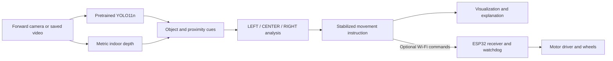

# VisionDrive

**Computer Vision–Based Obstacle Detection and Avoidance**

A forward-camera prototype that combines object detection, estimated depth and
three-region logic to display **FORWARD, LEFT, RIGHT or STOP**. Perception runs on
a laptop; an optional ESP32 receives expiring movement commands.

[Run the demo](#installation-and-setup) ·
[Evaluation notebook](notebooks/yolo11n_pretrained_evaluation.ipynb) ·
[Measured results](docs/evaluation_results.md) ·
[Dataset and sources](docs/dataset_card.md) ·
[Project materials](#required-project-materials)


*Actual application output. Image credits and modifications are documented in
[sample results](THIRD_PARTY_NOTICES.md#application-screenshot-attribution). This screenshot is separate from the
fresh evaluation study.*

## Project description

VisionDrive treats the camera as the vehicle's forward view. **Original pretrained
YOLO11n** identifies objects, while **Depth Anything V2 Metric Indoor Small**
estimates surface depth. The application examines the left, center and right
regions, then explains the resulting movement recommendation.

The visualization works without an ESP32 or physical car. It is a working academic
prototype; calibrated distance, independent vehicle-camera performance and
physical collision avoidance remain unvalidated.

## Group members

- Sean Xander Aquino
- Blessie Faith Bongalos
- Joshua Jericho Barja
- John Renzzo Montenegro
- John Carlo Nas
- Divino Al Ricafort

## Assigned group project specialization

**Computer Vision–Based Obstacle Detection and Avoidance** is the working
specialization title. The group must confirm the officially assigned wording.

## System overview and workflow



| Observation | Intended controller response |
| --- | --- |
| No nearby center obstacle | Continue forward after confirmation |
| Nearby center obstacle, usable side | Turn toward a usable side |
| Distant object | Keep it visible without automatically blocking movement |
| Emergency center clearance or all regions blocked | STOP |
| Invalid/stale input or expired motor commands | STOP |

The controller requires fresh observations and confirmation before authorizing
movement. The visual-result hold and physical-command freshness are separate.
See [the run guide](docs/laptop-esp32.md) for the exact behavior and configuration.

## Hardware used

| Hardware | Role and status |
| --- | --- |
| Laptop and integrated/USB camera | Perception and visualization |
| NVIDIA RTX 3050 6 GB Laptop GPU | Hardware used for the recorded CUDA evaluation |
| ESP32 | Optional movement-command receiver; no physical board trial claimed |
| Motor driver, motors, chassis and vehicle-mounted camera | Future physical integration |

The laptop runs YOLO and depth estimation. The current implementation does not
run these networks on the ESP32. The [hardware handoff](docs/laptop-esp32.md#hardware-implementation)
covers later integration.

## Software and tools

| Tool | Purpose |
| --- | --- |
| Python, PyTorch and torchvision | Model execution and CUDA support |
| Ultralytics YOLO11n | Original COCO-pretrained object detector |
| Transformers and Depth Anything V2 | Metric indoor depth estimation |
| OpenCV and NumPy | Camera/video handling, image processing and geometry |
| Pandas and Matplotlib | Evaluation tables and diagnostic figures |
| Jupyter Notebook | Executable research workflow |
| pytest and native C++ checks | Software and firmware safeguard verification |

CPU and GPU dependency files are provided separately. The recorded evaluation
used Python 3.13.5; package versions are saved in
[environment.json](docs/results/yolo11n/environment.json).

## Computer vision methodology

1. Capture a forward-facing camera frame or decode saved video.
2. Run the original 80-class YOLO11n detector.
3. Estimate depth and extract nearby surface cues, including unnamed obstacles.
4. Reject likely floor using a ground-plane heuristic.
5. Analyze occupancy and estimated clearance in three image regions.
6. Stabilize the recommendation and display its reason.
7. Optionally send short-lived commands to the ESP32 receiver.

Walls and generic boxes are not standard COCO categories. They may contribute
through the depth pathway without a recognized name. Depth estimates and floor
rejection require camera-specific validation; detection of every obstacle is
not guaranteed.

## Dataset overview

The final pretrained evaluation uses **400 fresh real indoor photographs**
selected from Open Images.

| Partition | Images | Person-positive | Verified person-negative | Person annotations |
| --- | ---: | ---: | ---: | ---: |
| Development | 80 | 60 | 20 | 191 |
| Test | 320 | 240 | 80 | 732 |
| **Total** | **400** | **300** | **100** | **923** |

The cohort contains one image per photographer profile. Previously inspected
pilot and historical baseline image IDs are excluded. Source-only selection,
image hashes and evaluation settings were frozen in commit
[`8a6f52a`](https://github.com/thebaynal/Vision-Drive/commit/8a6f52a)
before inference on the fresh test set.

Photos retain individual **CC BY 2.0** attribution; Open Images annotations are
**CC BY 4.0**. The group selected and prepared these public images; it did not
photograph them.

**Only person, original COCO ID 0, is primary-scored.** Pilot chair evaluation was
excluded because Open Images separates Stool from Chair, leaving incomplete
coverage for the COCO chair concept. The live detector retains all 80 categories.

- [Dataset card and source comparison](docs/dataset_card.md)
- [Frozen annotations and individual attribution](data/public/indoor-evaluation-manifest.jsonl)
- [Selection audit and source checksums](data/public/indoor-selection-audit.json)
- [Chair/Stool taxonomy audit](docs/dataset_card.md#chair-stool-taxonomy)

The historical ESPDet-Pico experiment separately retains its **402-image
training/validation/test dataset**. The unchanged YOLO study uses development/test
partitions and introduces no unnecessary training workflow.

## Model and algorithm used

| Component | Configuration |
| --- | --- |
| Object detector | Original pretrained YOLO11n; no project fine-tuning |
| Depth estimator | Depth Anything V2 Metric Indoor Small |
| Navigation logic | Three-region proximity analysis and stateful confirmation |
| Primary evaluation | Person only, preserving the original 80-class model |
| Historical baseline | Separately trained ESPDet-Pico bottle/cup/box detector |

Checkpoint hashes, class mappings, matching rules and uncertainty methods are
documented in the [evaluation methodology](docs/dataset_card.md#evaluation-methodology).
Historical ESP training records do not describe YOLO performance.

## Installation and setup

Run the following from the repository root in **Windows PowerShell**.

### NVIDIA GPU setup

```powershell
python -m venv .venv-evaluation
.venv-evaluation\Scripts\python -m pip install -r requirements-evaluation-gpu.txt
.venv-evaluation\Scripts\python scripts/setup_laptop_models.py
```

Use a compatible NVIDIA driver. The setup script explicitly downloads and checks
the model files; inference reads local checkpoints.

### CPU setup

Use a separate environment for CPU dependencies:

```powershell
python -m venv .venv-cpu
.venv-cpu\Scripts\python -m pip install -r requirements-evaluation.txt -r requirements-laptop.txt
.venv-cpu\Scripts\python scripts/setup_laptop_models.py
```

## Running the system

```powershell
# Live camera visualization with YOLO and depth.
.venv-evaluation\Scripts\python logic_demo.py --device 0

# Saved video, visualization only.
.venv-evaluation\Scripts\python logic_demo.py --device 0 --source path/to/video.mp4

# Object-only visualization.
.venv-evaluation\Scripts\python logic_demo.py --device 0 --detector coco

# CPU visualization.
.venv-cpu\Scripts\python logic_demo.py --device cpu
```

Without `--esp-host`, the application is visualization-only. The explicitly
synthetic `--simulate` mode illustrates logic and cannot issue motor commands.

See the [run guide](docs/laptop-esp32.md) for camera selection, recording, OBS
capture, calibration and ESP32 connection instructions.

## Reproducing the evaluation

### Download, validate and evaluate

```powershell
.venv-evaluation\Scripts\python scripts/download_dataset.py
.venv-evaluation\Scripts\python scripts/validate_annotations.py
.venv-evaluation\Scripts\python scripts/evaluate_pretrained.py --device 0
```

Acquisition restores the frozen manifest, verifies image hashes and reuses valid
cached data. No API key is required for this cohort. For CPU evaluation, use
`.venv-cpu\Scripts\python` and `--device cpu`.

### Run the notebook

```powershell
.venv-evaluation\Scripts\python -m ipykernel install --user --name visiondrive-evaluation --display-name "Python (VisionDrive evaluation)"
.venv-evaluation\Scripts\python -m jupyter lab notebooks/yolo11n_pretrained_evaluation.ipynb
```

Select **Python (VisionDrive evaluation)** and choose **Run All**.
For a CPU notebook run, register/select the CPU environment and set
`DEVICE='cpu'` in Section 2.

The notebook contains **12 labeled sections** covering the objective, environment,
acquisition, exploration, checkpoint verification, native evaluation, metrics,
class results, diagnostic plots, benchmarking, error analysis and interpretation.
All 11 code cells were executed successfully for the published study.
**No YOLO training or fine-tuning occurs.**

### Locate the outputs

Local outputs are written to `outputs/evaluation/yolo11n/`:

- Metrics and class tables
- Dataset validation, source attribution, configuration and environment
- Raw/normalized detection matrices and PR/F1 curves
- Class distribution and AP charts
- Ground-truth review sheets, predictions, missed detections and false positives
- Automatically generated research report

Compact published evidence is in [docs/results/yolo11n](docs/results/yolo11n)
and [assets/evaluation](assets/evaluation). Raw images, downloaded laptop weights
and full local runs remain outside Git.

## Sample results

**Person detection on 320 fresh test images, containing 732 annotated people:**

| Metric | Measured result |
| --- | ---: |
| Precision at confidence .35 | **79.19%** |
| Recall at confidence .35 | **63.93%** |
| F1 at confidence .35 | **70.75%** |
| AP@50 | **72.12%** |
| AP@75 | **54.02%** |
| AP@50–95 | **50.94%** |
| True positives / false positives / false negatives | **468 / 123 / 264** |

Only one category is primary-scored, so mAP equals that category's AP. These are
object-localization metrics, not ordinary classification accuracy or physical
obstacle-avoidance success. Evaluation uses NMS IoU .70; the live application's
default is .45.


| Timing measurement | Mean latency | Throughput from mean |
| --- | ---: | ---: |
| YOLO network inference | 9.19 ms | 108.82 FPS |
| YOLO predict call, including preprocessing/postprocessing and Python overhead | 14.92 ms | 67.01 FPS |
| Separate serial decode + YOLO + depth + controller + explanation rendering | 109.34 ms | 9.15 FPS |

Timing was measured on the RTX 3050. The YOLO benchmark used 100 images after
10 warmups with CUDA synchronization; the hybrid measurement used 20 images.
These measurements exclude live camera capture, GUI display and motor execution.

Read the [full report](docs/evaluation_results.md) for confidence intervals,
condition breakdowns, attributed failure examples and experimental limitations.

## Midterm evidence and limitations

The midterm asks **“Can the System SEE and RECOGNIZE?”** The
[midterm report](docs/documentation-and-paper-guide.md#midterm-evidence) maps the working pipeline, datasets,
image processing and evaluation artifacts to that requirement.

The historical ESPDet-Pico study preserves its
[training notebook](notebooks/train_bottle_cup_box.ipynb),
[training curves](assets/baseline-training-curves.png) and
[measured baseline report](docs/model-report.md). Its training/validation/test
partitions are separate from the unchanged pretrained YOLO experiment.

Current limitations:

- The primary score covers person only; furniture and the other 79 classes are unscored.
- Public interior photographs differ from a camera mounted on a mini car.
- Hash and photographer checks do not prove physical-scene independence or absence from COCO pretraining.
- Precision depends on the deliberately selected 75% positive / 25% negative image ratio.
- Metric-depth accuracy, independent vehicle-camera generalization and physical driving remain unmeasured.

The [independent camera protocol](docs/dataset_card.md#independent-camera-evaluation) covers future
recordings, reviewed annotations, depth references and acceptable movement actions.

## Repository guide

```text
visiondrive/       Live perception, controller, visualization and communication
  evaluation/     Offline research utilities
scripts/           Setup, dataset preparation, evaluation and camera import
notebooks/         Executed YOLO evaluation and historical/demo notebooks
config/            Application and evaluation settings
data/public/       Frozen manifests, attribution and source audits
docs/              Methodology, reports, writing guides and measured tables
assets/            Application examples, evaluation graphs and baseline curves
firmware/          ESP32 command receiver and watchdog
tests/             Python and native firmware checks
```

## Required project materials

| Material | Location |
| --- | --- |
| Main research notebook | [Pretrained YOLO11n evaluation](notebooks/yolo11n_pretrained_evaluation.ipynb) |
| Dataset sources and licenses | [Dataset card](docs/dataset_card.md) |
| Methodology and measured results | [Methodology](docs/dataset_card.md#evaluation-methodology) · [Report](docs/evaluation_results.md) |
| Presentation and paper guidance | [Presentation script](docs/documentation-and-paper-guide.md#presentation-script) · [Writing guide](docs/documentation-and-paper-guide.md) |
| Historical dataset/training paper section | [ESPDet paper section](docs/model-report.md#historical-methodology) |
| Hardware implementation | [Hardware handoff](docs/laptop-esp32.md#hardware-implementation) |
| Verification | [139 Python tests and integration checks](docs/verification.md) |

## References and attribution

- [Ultralytics YOLO11](https://docs.ultralytics.com/models/yolo11/)
- [Depth Anything V2](https://github.com/DepthAnything/Depth-Anything-V2)
- [Espressif ESP-Detection](https://github.com/espressif/esp-detection)
- [Open Images annotation protocol](https://storage.googleapis.com/openimages/web/factsfigures_v7.html)
- [Open Images download specification](https://storage.googleapis.com/openimages/web/download_v7.html)
- [The Open Images Dataset V4 paper](https://arxiv.org/abs/1811.00982)

Individual photographer credits, licenses and modifications accompany the
manifests and sample figures. See [third-party notices](THIRD_PARTY_NOTICES.md).
No project-wide redistribution license is implied.
