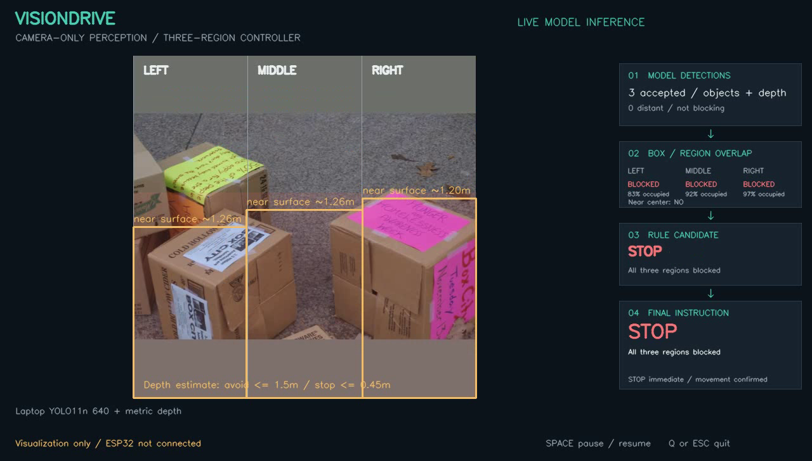

# Third-party notices and provenance

This repository contains documentation, application/tooling code, tests and artwork for pretrained YOLO11n. External source, initialization checkpoints, datasets, and full training runs remain ignored. Links identify dependencies; they do not transfer ownership to VisionDrive.

## Upstream components

| Component | Intended use | Source / license reference |
| --- | --- | --- |
| PyTorch and torchvision | Desktop inference | [PyTorch](https://github.com/pytorch/pytorch), [torchvision](https://github.com/pytorch/vision) |
| Ultralytics / YOLO11n | Pretrained laptop detector | [Repository and licensing information](https://github.com/ultralytics/ultralytics) |
| Depth Anything V2 Metric Indoor Small | Pretrained laptop depth model; Apache-2.0 | [Model and license](https://huggingface.co/depth-anything/Depth-Anything-V2-Metric-Indoor-Small-hf) |
| Hugging Face Transformers | Depth preprocessing and model implementation | [Repository and license](https://github.com/huggingface/transformers) |
| Arduino-ESP32 | Wi-Fi motor receiver firmware platform | [Repository and license](https://github.com/espressif/arduino-esp32) |
| OpenCV | Image capture, video, and presentation overlay | [Repository and license](https://github.com/opencv/opencv) |
| Open Images | Indoor evaluation and application example image sources | [Download and attribution information](https://storage.googleapis.com/openimages/web/download_v7.html) |
| COCO / pycocotools | Secondary bottle/cup benchmark images, original annotations and official evaluator | [COCO downloads and terms](https://cocodataset.org/#download), [COCO API source/license](https://github.com/cocodataset/cocoapi), [per-image license metadata](data/public/coco-objects-manifest.jsonl) |
| Shields.io | Remote README status badges | [Service](https://shields.io/) |

Ultralytics YOLO11n retains its upstream licensing terms. The pretrained architecture and weights are not original VisionDrive inventions.

## Provenance records

For each source dependency, record repository URL, exact revision, dependency versions, license files, and any local modifications. For a checkpoint, record its download URL, SHA-256 hash, original task/classes, source license, and fine-tuning configuration. Do not infer weight usage terms solely from the repository name.

For every dataset image, retain:

- Dataset version, image ID, original source URL, author and license metadata where supplied.
- Original object labels, bounding boxes, and the mapping to `obstacle`.
- Split assignment and any annotation edits.
- Retrieval date and file hash for reproducibility.

Dataset annotation terms and individual image terms can differ. Preserve attribution and validate redistribution rights before publishing images or presentation recordings. Prefer manifests and download instructions over committing the dataset.

## Project licensing

No project-wide redistribution license is declared. This file is an attribution inventory, not a replacement for an upstream license. Keep applicable third-party notices intact.

## Laptop models and sample images

`scripts/setup_laptop_models.py` downloads YOLO11n from the official Ultralytics
v8.3.0 assets release and metric indoor depth from Hugging Face revision
`8078d68a9c75a972131914f6afd0c1723be0da7f`. Both checkpoints are SHA-256 checked.
Downloaded weights/configuration and their generated source manifest remain
ignored in `weights/laptop/`. The YOLO checkpoint retains upstream AGPL-3.0
terms; the small depth model is Apache-2.0. These are upstream pretrained models,
not trained from scratch by the group.

The actual model-output screenshots in `assets/laptop-demo.png` and
`assets/unknown-obstacle-demo.png` include modified public images. Authors,
original image URLs, CC BY 2.0 license links, source IDs, and modifications
are recorded in [sample-result attribution](THIRD_PARTY_NOTICES.md#application-screenshot-attribution).
## Current pretrained evaluation cohort

The indoor person photos retain individual CC BY 2.0 authors, original
pages and license links in `data/public/indoor-evaluation-manifest.jsonl`.
Open Images annotations are CC BY 4.0. Ground-truth and prediction overlays
modify source photos only for research visualization; originals remain cached
outside Git. Published example metadata accompanies each selected image.
See [the dataset card](docs/dataset_card.md) for attribution, source-release
checksums, exclusions, candidate comparisons and independence limitations.
YOLO11n remains the original upstream checkpoint and is never fine-tuned in
this experiment. No new YOLO training checkpoint is packaged.

## Application screenshot attribution

Recorded on 2026-10-16 using real pretrained-model inference. No board or motors were connected.

### Actual bottle recognition and distance-aware continuation

Actual bottle recognition and distance-aware continuation. A distant bottle remains visible without blocking the center.

Instruction in this recorded frame: **FORWARD** — No nearby center obstacle detected. Distances are learned estimates and labels may be wrong; this is an integration example, not a calibrated course test.

Source image: Open Images ID `487815c82c579830`, author **Kasia**, [original image](https://farm1.staticflickr.com/2097/2258189812_98f8dcc2f1_o.jpg), [image license](https://creativecommons.org/licenses/by/2.0/). VisionDrive resized the image and added model predictions/instruction overlays. The original file hash and source metadata are retained in [application image attribution](assets/application-source-attribution.json).

### Actual depth-based near surfaces on a box scene

Actual depth-based near surfaces on a box scene. No box class is required; the conservative result is STOP.

Instruction in this recorded frame: **STOP** — All three regions blocked. Distances are learned estimates and labels may be wrong; this is an integration example, not a calibrated course test.

Source image: Open Images ID `995243986ca2dd84`, author **Justin Henry**, [original image](https://farm5.staticflickr.com/2357/1940024041_e7bc88652f_o.jpg), [image license](https://creativecommons.org/licenses/by/2.0/). VisionDrive resized the image and added model predictions/instruction overlays. The original file hash and source metadata are retained in [application image attribution](assets/application-source-attribution.json).

### Interpretation and measurement limits

The six-second input produced 179 display frames and 11 unique processed observations. The application ended in STOP / VIDEO ENDED. Median combined inference time was 477 ms on this development CPU, excluding camera capture/rendering. The application drops old frames to avoid an inference backlog. These counts and timing are integration evidence, not an avoidance-accuracy score.

LEFT/RIGHT behavior is covered by controller and known-depth-field tests. This particular public-image clip produced FORWARD and STOP; it is not evidence of successful physical turning. See [machine-readable smoke results](docs/laptop-smoke-results.json), [verification](docs/verification.md).
