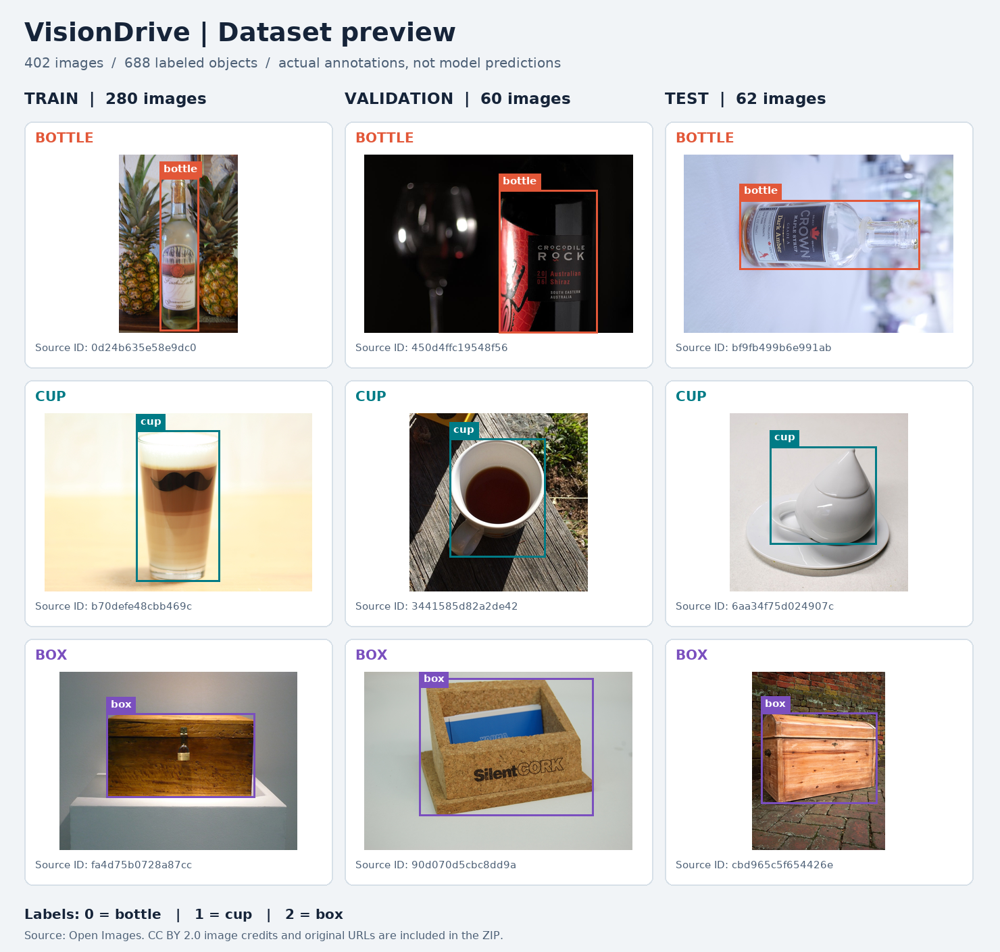

# VisionDrive dataset card

## Current YOLO11 fine-tuning dataset: version 2

The current three-class fine-tuning dataset contains **435 images and 730
annotated instances**. It extends the original dataset with **33 additional box
training photos**, preserving every existing validation/test assignment.

| Split | Total images | Bottle images | Cup images | Box images |
| --- | ---: | ---: | ---: | ---: |
| Training | 313 | **125** | **108** | **80** |
| Validation | 60 | 27 | 23 | 10 |
| Testing | 62 | 27 | 24 | 11 |
| Total | 435 | 179 | 155 | 101 |

Counts above are **unique images containing a class**, not bounding boxes or
augmented copies. Each class exceeds 60 training images. Training has 294
bottle, 136 cup, and 115 box instances; validation has 48/28/15 and test has
43/25/26 instances respectively.

The original photos came from the official Open Images validation pool. The
additional box photos came from its official test pool and are assigned to
**project training only**. These are new project partitions, not official Open
Images benchmark splits. Source photos and annotations were gathered by Open
Images; the group prepared and converted the subset. All 435 image records
retain their authors, original URLs, SHA-256 hashes, and CC BY 2.0 license links.

Use the [version 2 manifest](yolo-bottle-cup-box-v2-manifest.jsonl) and
[preparation audit](yolo-bottle-cup-box-v2-preparation.json). Restore its exact
photos and labels on another computer with:

```powershell
.venv-inference\Scripts\python scripts/restore_dataset.py --manifest data/public/yolo-bottle-cup-box-v2-manifest.jsonl --output datasets/yolo-bottle-cup-box-v2 --download
```

The dataset and raw source downloads remain outside Git. The download below is
the **original 402-image version**, not the expanded version 2. The manifest
restore command above supplies the expanded dataset. See the
[fine-tuned YOLO11 report](../../docs/yolo11-finetuning-report.md).

## Original baseline dataset: version 1

The group prepared **402 images / 688 annotated instances** for the original
bottle/cup/box ESPDet experiment. The unchanged 80-class YOLO and depth branches
also retain their upstream pretraining data; this card describes project data.

## Preview and download



These are actual annotated examples from the training, validation, and testing
sets, not predictions or generated images. The preview resizes source images
and adds label overlays. Image authors, original URLs, CC BY 2.0 license links,
and source IDs are retained in [preview attribution](preview-sources.json).

- [Download the complete dataset ZIP (about 100 MB)](https://github.com/thebaynal/Vision-Drive/releases/download/dataset-v1.0.0/VisionDrive-bottle-cup-box-dataset.zip)
- [Dataset release page and checksum](https://github.com/thebaynal/Vision-Drive/releases/tag/dataset-v1.0.0)

The ZIP contains all 402 original images, 402 corresponding YOLO label files,
a portable `dataset.yaml`, the fixed source/split manifest, a preview,
per-image attribution, and usage instructions. Extract it before using it
with a trainer. The original image hashes, annotation pairs, and ZIP contents
were verified during packaging.

| Split | Images | Bottle instances | Cup instances | Box instances |
| --- | ---: | ---: | ---: | ---: |
| Training | 280 | 294 | 136 | 73 |
| Validation | 60 | 48 | 28 | 15 |
| Testing | 62 | 43 | 25 | 26 |

Source: Open Images official validation image/box pool, repartitioned into
new **project** splits after content deduplication and stratification. These
are not the official Open Images benchmark partitions. The source annotations
map Bottle → bottle, Coffee cup → cup, and Box → box. Labels are class IDs
0/1/2 with normalized bounding boxes. Boxes marked depiction/group are excluded.

[The fixed manifest](bottle-cup-box-manifest.jsonl) records each image's
content hash, ID, relative prepared path, project split, source URL, author,
license, and original boxes. Image files are downloaded separately rather than
bundled in Git. Annotations and individual images retain their upstream terms;
see [attribution](../../THIRD_PARTY_NOTICES.md).

## Reconstruct the prepared splits

For an explanation of dataset preparation, fine-tuning, and measured results,
read the [formal paper section](../../docs/paper-dataset-and-training.md) or
[presentation script](../../docs/dataset-and-training-presentation-script.md).

After installing the model requirements:

```powershell
.venv-inference\Scripts\python scripts/restore_dataset.py --download
```

This restores the exact published split, verifies image SHA-256 values, and
creates ignored `datasets/bottle-cup-box/` images, YOLO labels, and dataset YAML.
It refuses to overwrite an existing output dataset. Use `--output` for another
location. Existing verified source images in the local cache are reused.
Public image availability can change; a missing or changed image fails rather
than silently substituting another one.

The original sampling/training procedure remains in
[the training notebook](../../notebooks/train_bottle_cup_box.ipynb).

## Unseen situations and limitations

The three sets contain distinct file content. A random image-level split does
not prove different capture sessions, different real-world objects, or absence
from upstream models' pretraining. The old test images were used for the
published baseline evaluation and later integration illustrations. They must
not be presented as a fresh, prospective test for the newer hybrid system.

For the vehicle-view evaluation, collect new recordings at the intended camera
height and keep whole sessions/locations in one split. Reserve object instances,
lighting conditions, backgrounds, distances, angles, and obstacle arrangements
that do not occur in training. Include verified empty floor, clutter, walls,
small/thin objects, partial occlusion, and near/far transitions. Audit labels so
an unannotated obstacle is not incorrectly treated as background. Reserve a new
test session before threshold/model tuning and report its results separately.

The existing dataset is small, has relatively few box images, and is not a
comprehensive annotation set for arbitrary obstacles or drivable floor. It
supports the baseline training milestone; it does not establish universal
obstacle detection or real-car avoidance accuracy.
