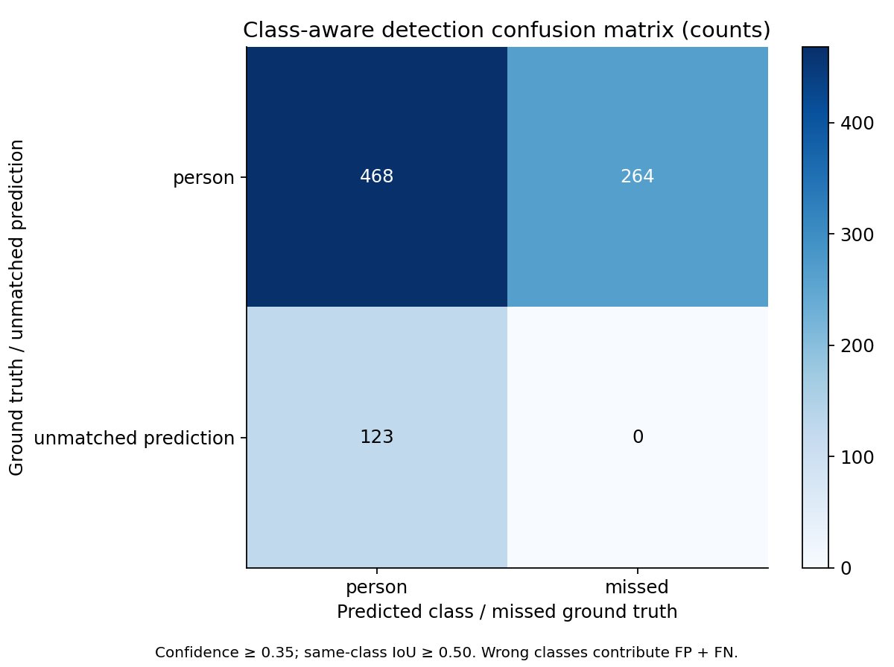
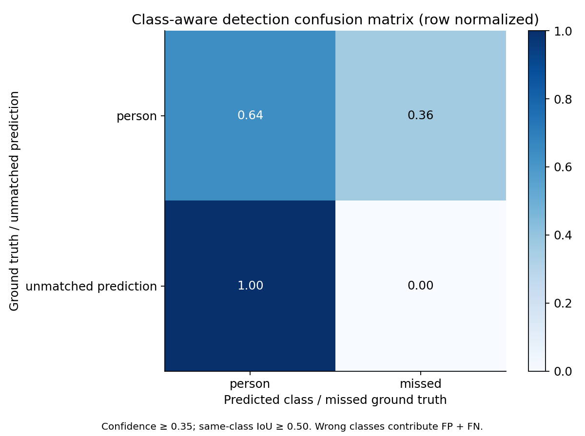
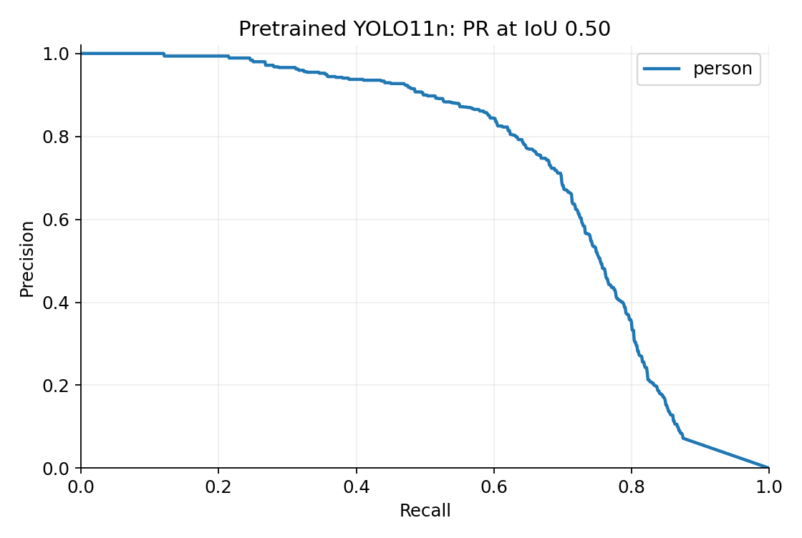
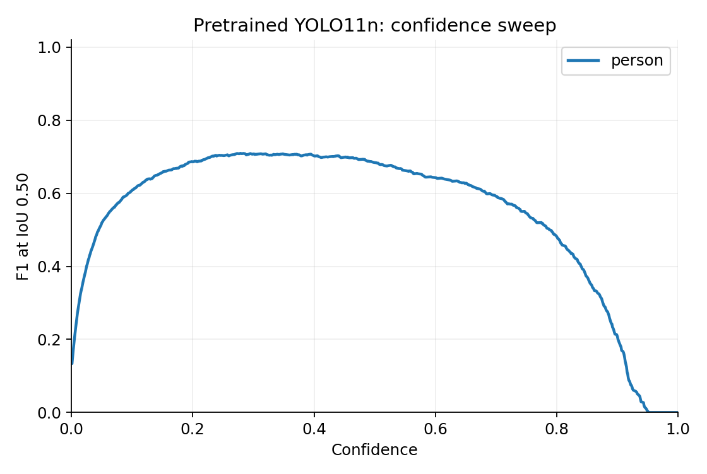
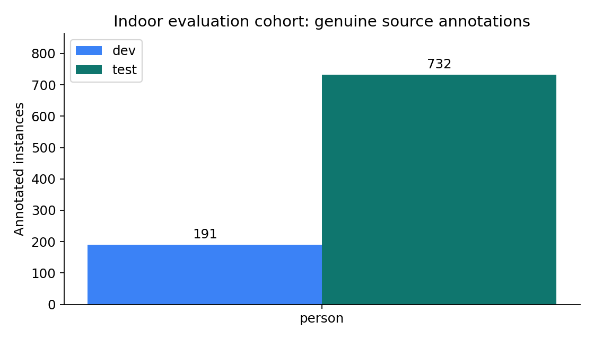
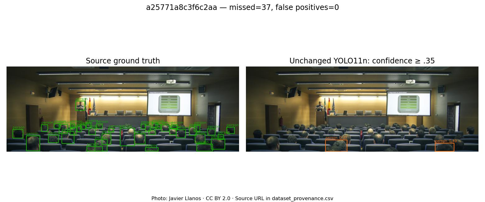
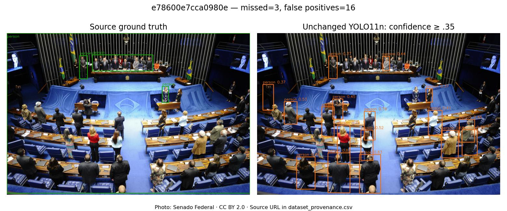

# Pretrained YOLO11n indoor evaluation

## 1. Objectives
Measure unchanged COCO-pretrained object recognition in real indoor photographs. This is not a collision-avoidance trial.

## 2. Dataset and sources
400 validated images: 80 development, 320 test. Original Open Images validation/test assignments are retained. Fresh Building-family interiors have verified person presence/absence; prior inspected and baseline images are excluded. There is one image per photographer and 75% person-positive / 25% verified person-negative images in each split. Only PERSON is primary-scored; chair is excluded because source Stool and Chair do not exhaustively cover the COCO chair concept.
Photos: individual authors, CC BY 2.0; annotations: Google/Open Images, CC BY 4.0. Attribution is in `dataset_provenance.csv`.
[Open Images annotation protocol](https://storage.googleapis.com/openimages/web/factsfigures_v7.html) · [Downloads and attributes](https://storage.googleapis.com/openimages/web/download_v7.html).

## 3. Model
Original YOLO11n COCO checkpoint SHA-256: `0ebbc80d4a7680d14987a577cd21342b65ecfd94632bd9a8da63ae6417644ee1`. No training or fine-tuning. Primary ID person=0; all 80 model names are retained. Parameters before fusion: 2,624,080; after inference fusion: 2,616,248.

## 4. Experimental setup
Input 640×640 letterboxed, FP32, batch 1. Device: NVIDIA GeForce RTX 3050 6GB Laptop GPU. Environment and source digests are recorded in JSON. Git: `8a6f52ad5d3b2f1edef7257b7b4c35e72da7780c`; dirty=True.

## 5. Ground truth
Human-verified person image labels and exhaustive source boxes are required. Whole images with target group-of, depiction, inside-target, unknown flags or label conflicts are excluded. Person subcategories are propagated, coincident cross-category boxes merged at IoU ≥ .95. Remaining cross-source person overlaps at IoU > .30 cause whole-image exclusion. This rule was frozen from pilot QA before fresh-cohort inference. Source protocol and visual spot checks are not independent exhaustive reannotation. No model-generated ground truth.

## 6. Definitions
Operational P/R/F1 use confidence ≥ .35 and greedy confidence-ordered same-class one-to-one IoU ≥ .50 matching. Undefined ratios are zero. Micro sums counts; macro F1 is the arithmetic mean of class F1, not the harmonic mean of macro P/R. AP is native Ultralytics integration at confidence floor .001, NMS IoU .70, max 300 detections. Only person is primary-scored, so mAP equals person AP. It is not classification accuracy.

## 7. Overall results
Micro precision 0.7919; recall 0.6393; F1 0.7075; TP=468, FP=123, FN=264.
mAP@50=0.7212; mAP@75=0.5402; mAP@50–95=0.5094. Macro F1=0.7075.
95% group-bootstrap intervals for micro P/R/F1: {'precision': [0.7244933434145763, 0.8538407976827095], 'recall': [0.5576386886770518, 0.7129589434785121], 'f1': [0.6474937108586911, 0.7620732234549179]}. Resampling unit: photographer (scene proxy), 320 test groups, 1,000 resamples. No AP interval claimed.

## 8. Per-class results
| Class | GT | TP | FP | FN | P | R | F1 | AP50 | AP75 | AP50–95 |
|---|---:|---:|---:|---:|---:|---:|---:|---:|---:|---:|
| person | 732 | 468 | 123 | 264 | 0.792 | 0.639 | 0.707 | 0.721 | 0.540 | 0.509 |

## 9. Error analysis
Measured condition breakdown (recall; observational and confounded, not causal):
| Condition | TP / ground truth | Recall |
|---|---:|---:|
| dark_mean_<70 | 25/41 | 0.610 |
| few_targets_<5 | 298/394 | 0.756 |
| large_>=96px | 347/407 | 0.853 |
| many_targets_>=5 | 170/338 | 0.503 |
| medium_32-96px | 121/243 | 0.498 |
| not_occluded | 233/297 | 0.785 |
| not_truncated | 307/529 | 0.580 |
| occluded | 235/435 | 0.540 |
| other_luminance | 443/691 | 0.641 |
| small_<32px | 0/82 | 0.000 |
| truncated | 161/203 | 0.793 |

Miss and false-positive examples are exported in `prediction_examples/`. Object overlap/background complexity and perspective have no independent condition labels; the example sheets support qualitative review, not invented quantitative claims.

## 10. Computational performance
After 10 warmups, 100 in-memory frames: model inference mean 9.19 ms, median 8.44 ms, population SD 1.75 ms, model-only throughput 108.8 FPS.
Preprocessing 2.99 ms; postprocessing 2.29 ms; Python predict-call wall mean 14.92 ms (67.0 FPS). CUDA synchronization: True. Disk decode, capture, depth, display, UDP and motor execution excluded.

## 11. Threats to validity
The 400-image target is a practical sample, not proof of generalization. Selection is stratified to 75% person-positive images, so precision depends on this chosen prevalence. Only person is primary-scored. Pilot figure QA found a Chair/Stool taxonomy mismatch; the pilot is exploratory, and the corrected person-only protocol was frozen before inference on the fresh cohort. Neither thresholds nor image selection were optimized from final test scores. Public interior photos differ from a low-mounted car camera. Exact/near duplicates and shared photographers are controlled within the cohort, but physical scene identities and COCO pretraining overlap are unproven. Published COCO benchmarks are external references only.
Depth evaluation: pending: no metric depth ground truth in selected images. Camera evaluation: pending: no independent team recordings supplied.

## 12. Conclusions
These measurements describe pretrained person localization on this explicitly selected indoor cohort. They do not validate furniture recognition or all-obstacle detection. Missed people and false detections remain. Depth cues and safeguarded movement recommendations need separate reference measurements and physical trials before navigation performance can be claimed.

## Submission evidence

[Measured JSON](results/yolo11n/metrics.json) · [Tables](results/yolo11n/per_class_metrics.csv) · [Per-image counts](results/yolo11n/per_image_counts.csv) · [Image/source attribution](results/yolo11n/dataset_provenance.csv) · [Taxonomy exclusion audit](dataset_card.md#chair-stool-taxonomy).

Photo credits and original pages are recorded in [image-attribution.json](../assets/evaluation/image-attribution.json).

## Separate hybrid processing benchmark

Over 20 images, serial decode + YOLO11n + depth + controller + render averaged 109.34 ms (9.15 FPS). This excludes camera, async scheduling, GUI and motors. It is separate from person-only YOLO timing.

## Bottle and cup detection: additional measured benchmark

We also ran the **same unchanged YOLO11n on all 5,000 COCO val2017 images**
using the RTX 3050. This includes 641 images with bottle and/or cup annotations
and 4,359 images containing neither, so false alarms are included. There was
**no training or fine-tuning**. The original 80-class detector is preserved.

| Object | Ground-truth instances | Precision | Recall | F1 | AP50 | AP75 | AP50–95 |
| --- | ---: | ---: | ---: | ---: | ---: | ---: | ---: |
| Bottle | 1,013 | 77.86% | 32.28% | 45.64% | 48.32% | 35.73% | 32.06% |
| Cup | 895 | 70.94% | 39.55% | 50.79% | 49.48% | 38.44% | 35.61% |

P/R/F1: confidence ≥ .35 and matching IoU ≥ .50. AP: official `pycocotools`
COCO bounding-box evaluation, IoUs .50:.05:.95, 101 recall points, all areas,
maxDets=100; 640×640 letterboxing, FP32, NMS .70 and AP confidence floor .001.
COCO crowd/ignore handling is retained. The instance counts exclude 12 bottle
and 4 cup crowd regions; these regions are handled by the evaluator.

**This is a known upstream COCO validation benchmark, not an independent unseen
car-camera test.** It is separate from the person-only Open Images study and
from Ultralytics' published 80-class mAP. These detection metrics do not measure
movement-instruction correctness or physical avoidance.

The configuration and complete manifest were frozen in
[`127dfbe`](https://github.com/thebaynal/Vision-Drive/commit/127dfbe) before this
experiment's inference. See the [measured JSON](results/yolo11n-coco-objects/metrics.json),
[per-class CSV](results/yolo11n-coco-objects/per_class_metrics.csv),
[image hashes](results/yolo11n-coco-objects/image_checksums.csv),
[source/individual license manifest](../data/public/coco-objects-manifest.jsonl), and
[methodology](dataset_card.md#secondary-bottle-and-cup-benchmark).
Source: [COCO](https://cocodataset.org/#download), with its original human annotations.

Fixed-point detection counts:

| Class | TP | FP | FN |
| --- | ---: | ---: | ---: |
| bottle | 327 | 93 | 686 |
| cup | 354 | 145 | 541 |
