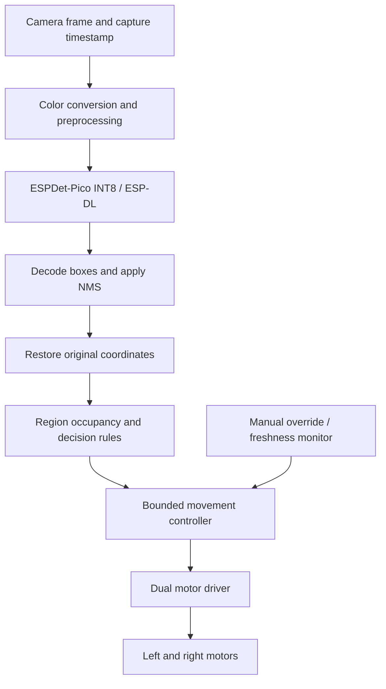

# Hardware implementation guide

> Status: future implementation instructions. No board, pin assignment, motor rating, firmware build, or physical driving behavior has been validated for VisionDrive yet.

This guide describes how to transfer the desktop detector and three-region controller to a slow indoor mini car. It is intended to be followed after the [desktop milestone](implementation-plan.md) is working and its evaluation is recorded. Autonomous obstacle perception remains entirely camera-based.

## 1. Target architecture and readiness gates



Advance in stages: saved-image inference, live instructions with motors disconnected, raised-wheel motor tests, then supervised low-speed trials. A working desktop model or successful firmware build is not evidence that physical movement is ready.

## 2. Hardware selection

| Component | Selection requirement | Record before wiring |
| --- | --- | --- |
| Camera controller | ESP32-S3 camera board with at least 8 MB PSRAM; enough flash for firmware/model and sufficient exposed GPIO | Exact board revision, schematic, flash/PSRAM configuration, camera pin map |
| Camera | Sensor supported by the selected board and camera component | Sensor, lens/view angle, resolution, pixel format, orientation |
| Chassis | Small two-wheel differential-drive chassis with geared motors and stable support/caster | Wheel diameter, wheel track, ground clearance, approximate mass |
| Motor driver | Dual H-bridge with 3.3 V-compatible inputs and adequate voltage/current/thermal capability | Data sheet, truth table, continuous/peak current conditions, brake/coast behavior |
| Motors | Geared motors suitable for controlled low-speed movement | Rated voltage, no-load current, stall current, gear ratio |
| Power | Battery matched to motors and regulator matched to board input | Full-charge battery voltage, regulator output/current, protection and connector polarity |
| Override | Accessible physical motor-power switch and manual disarm input | Wiring, active state, behavior during boot/reset |
| Mount and wiring | Rigid forward camera mount, secured wiring, suitable decoupling | Camera height/pitch, cable routing, fuse/protection arrangement where applicable |

Do not choose a driver from a headline peak-current figure alone. Check whether it can support the motors' starting/stall load for the expected duration without exceeding its thermal limits. Both motors and the camera can produce current transients.

No ultrasonic, ToF, LiDAR, or wheel-encoder input is needed by this design. A manual stop or electrical fault signal does not replace camera perception; it only inhibits movement.

### GPIO budget before purchase

List every camera, PSRAM/flash, USB/debug, boot-strap, and onboard-peripheral pin already in use. Then allocate motor direction, PWM, enable/standby, and manual-disarm signals according to the chosen driver's interface. Some integrated camera boards expose very few usable pins. Prefer a board with enough verified free outputs instead of adding an unplanned GPIO expander.

Do not use the original ESP32-CAM pinout for an ESP32-S3 board. Board names alone do not identify wiring or PSRAM configuration.

## 3. Wiring preparation and power

### Signal assignment worksheet

**TBD values below must be filled from the selected board schematic and driver data sheet. They are not instructions to connect an arbitrary GPIO.** If the driver uses a different control interface, update the signal list before wiring.

| Logical signal | Board GPIO / connector | Destination | Required checks |
| --- | --- | --- | --- |
| Left motor direction inputs | TBD | Driver left-channel logic | Free output pins, correct logic level, reset state |
| Left motor PWM | TBD | Driver left speed input | PWM support, timer/channel allocation |
| Right motor direction inputs | TBD | Driver right-channel logic | Free output pins, correct logic level, reset state |
| Right motor PWM | TBD | Driver right speed input | Independent duty control |
| Driver enable / standby | TBD | Driver enable | Disabled at reset, correct polarity, pull resistor if needed |
| Manual disarm | TBD | Switch/control input | Defined default state, debounce, accessible control |
| Ground | Board GND | Driver/regulator logic reference | Shared reference, short controlled return path |
| Logic supply | Per data sheet | Board / driver logic rail | Rated voltage, current capacity, no backfeed |
| Motor supply | Per data sheet | Driver power rail through switch | Battery full-charge voltage, current and polarity |
| Motor outputs | Driver channel outputs | Motors | No connection to ESP32 GPIO or supply pins |

### Power rules and checks

- Motors must be supplied through the driver, never from GPIO or the board's 3.3 V regulator.
- Use regulated board power as specified by the board vendor. The module's 3.3 V logic rating is not permission to connect a battery to a board input.
- Route motor current separately from sensitive logic/camera return paths while maintaining the required common ground reference.
- Follow vendor guidance for driver capacitors, motor suppression, wire gauge, regulator decoupling, and battery protection.
- Check how USB and battery power interact on the selected board before connecting both. Avoid feeding one source into another.
- Initialize enable low/disabled and zero duty before configuring the remaining control signals. Verify actual behavior during reset and brownout.
- The physical motor switch must remove motor power independently of inference software. Loss of power may cause coasting, not active braking; measure the result.

First verify supplies with motors disconnected. Reconnect motor power only for the appropriate bring-up stage.

## 4. Camera placement and coordinate calibration

Mount the camera rigidly, looking forward with enough downward view to see the course and approaching obstacles. Document height, pitch, lens, rotation, and image dimensions. A camera moved after calibration invalidates the geometry assumptions.

Use the same orientation for model input, restored detections, debug display, and controller. A horizontal mirror swaps left and right. A vertical flip makes the near area meaningless. Check with a labeled object placed on the physical left, right, and near-center positions.

Equal thirds and the desktop's 0.40/0.80 vertical thresholds are demonstration defaults. For hardware, project the car's actual forward width plus clearance onto a flat marked floor at several measured positions. Refine the middle corridor, potentially to a trapezoid, and re-run the geometry tests. A side third is not the car's complete swept turning path.

Calibrate the near-stop boundary with supported objects at measured positions across the test course. Bounding-box bottoms can be affected by object height, occlusion, and box error. Treat this as a restricted empirical stop trigger, not a general monocular distance sensor. Transparent objects, drop-offs, unknown surfaces, and untrained obstacles remain outside the validated course.

## 5. Toolchains and version records

Use separate desktop-training, export/quantization, and firmware environments. Pin each compatible stack after smoke testing. Record:

- ESP-Detection, ESP-DL, ESP-PPQ, and camera-component commits/versions.
- ESP-IDF version and toolchain; use the versions required by the selected ESP-DL/component releases rather than assuming the newest IDF works.
- Python, PyTorch, torchvision, Ultralytics, ONNX, and quantization-package versions.
- Model hash, class mapping, input shape, preprocessing, decoder, confidence and NMS thresholds.
- Board revision, flash layout, PSRAM settings, selected partition table, and actual model storage location.

The upstream repository describes ESP-IDF 5.3 or later for its documented workflow, but individual component constraints still need to be reconciled. Do not copy an old generated template into an untested latest ESP-DL checkout and assume compatibility.

## 6. Export and INT8 calibration

### Step A — Establish the desktop reference

Freeze the selected obstacle checkpoint and its hash. Save a fixed reference image set with expected desktop detections, restored coordinates, and decisions. Include bottles, cups, boxes, empty scenes, region-boundary overlaps, and near-area examples. Keep evaluation images independent of training and quantization calibration.

### Step B — Export with the upstream custom exporter

Use ESP-Detection's custom export path, not a generic export that loses the ESP-specific detection head or output contract. Inspect the pinned `deploy/export.py`, use its `Export` interface, and record input/output tensor shapes and decoding assumptions. The current source uses static deployment shapes and custom detection outputs; verify them for the pinned revision.

Create a 224 × 224, batch-one ONNX export. Check the graph and run reference images through the appropriate desktop ONNX validation path. Compare decoded boxes and class scores with the original model before quantization. A file successfully exporting does not establish prediction parity.

### Step C — Reconcile preprocessing before calibration

**Important integration check:** the upstream calibration loader currently resizes images directly to the requested dimensions, while this project's desktop design preserves aspect ratio with letterboxing. Do not mix those geometries silently.

Keep the project's aspect-ratio-preserving policy and adapt the calibration loader and firmware preprocessing to match it. Match interpolation, padding color, RGB/BGR order, channel layout, numeric range, and any normalization exactly. Avoid double scaling when an ESP-DL image adapter already handles a conversion. Recheck this behavior against the pinned toolchain because implementations can change.

Use representative camera/course images for calibration, covering the expected lighting and object sizes. Keep the calibration list and hashes. Confirm that enough images/batches are available for the quantizer's configured calibration steps; do not silently calibrate on one repeatedly cycled image. The model manifest must identify any calibration-loader change.

### Step D — Quantize for ESP32-S3

Invoke the pinned upstream `quant_espdet` workflow with target **`esp32s3`**, 8-bit quantization, and the verified input/calibration settings. Upstream examples may default to ESP32-P4; do not keep that target by accident. Inspect layer/operator support and the error report before accepting the `.espdl` artifact.

Prefer the individual export and quantization steps during development. The upstream all-in-one script can retrain the model and generate a project; it is not an inference-only launcher. If later used, review its training settings, target, and generated dependencies first.

### Step E — Evaluate the quantized model

Compare original, ONNX, quantized-reference outputs where supported by the tools, and saved-image inference on the actual S3. Use the same held-out samples and postprocessing. Record precision/recall and changed movement decisions. Revisit calibration if errors disproportionately affect near-center hazards. Do not compensate for a broken conversion by quietly lowering confidence until boxes reappear.

Model package contents should include weights/artifact hash, source checkpoint, export settings, calibration manifest, class mapping, preprocessing specification, test results, and compatible component revisions. Store large artifacts outside Git.

## 7. Firmware modules and data contracts

| Module | Responsibility |
| --- | --- |
| Camera capture | Own buffers; assign sequence ID and monotonic capture time |
| Preprocessing | Match trained/calibrated tensors; retain geometry transform |
| Detector | Run ESP-DL; decode outputs and NMS using verified model contract |
| Geometry | Restore camera coordinates; calculate region overlaps and near status |
| Decision logic | Port the desktop rule table and stabilization |
| Movement controller | Apply disarm/freshness checks, speed limits, and bounded motor output |
| Diagnostics | Report timestamps, latency, memory, decisions, and faults without blocking control |

Use bounded storage for detections and validate counts/coordinates. Return frame buffers correctly and avoid allocating large tensors each frame. Account for model activations, camera buffers, conversion buffers, task stacks, and required internal/DMA memory; free PSRAM alone does not prove enough usable memory.

### Suggested logical interfaces

These are implementation contracts, not existing firmware declarations:

```text
Detection:
  x1, y1, x2, y2   normalized original-frame coordinates
  confidence       finite value in [0, 1]
  class_id         0 = obstacle

PerceptionResult:
  frame_id
  captured_at_us   monotonic timestamp
  completed_at_us
  detections[]
  region_blocked   left, middle, right
  near_center
  valid

Decision:
  action          STOP | FORWARD | LEFT | RIGHT
  reason
  source_frame_id
  captured_at_us
  valid_until_us

MotorCommand:
  left_duty       bounded signed normalized command
  right_duty      bounded signed normalized command
  enabled
  expires_at_us
```

Queue the latest result instead of accumulating stale frames. Motor output must be controlled by a periodic task independent of inference, so a stalled detector cannot leave the previous command running indefinitely. Use atomic/copy-safe result handoff, monotonic timestamps, and a default disabled state. A task watchdog complements, but does not replace, the motor command expiry check.

## 8. Movement logic and motor translation

Port the desktop's rule ordering and overlap calculations exactly first. Share synthetic test fixtures across Python and firmware, including boundary cases, so differences in floating-point or rectangle handling are visible. Later geometry changes require updated fixtures and documentation in both paths.

For a two-motor differential drive:

| Instruction | Initial physical behavior |
| --- | --- |
| STOP | Zero movement demand, then driver-specific measured stop behavior |
| FORWARD | Both wheels forward with calibrated low duty |
| LEFT | Right wheel forward, left wheel slower or stopped |
| RIGHT | Left wheel forward, right wheel slower or stopped |

Start with forward-only arcs. Do not add automatic reverse or pivot turns until the course, field of view, and chassis behavior have been separately evaluated. Turning must not continue after a near-center stop decision.

Measure each wheel's starting duty, direction, and minimum repeatable motion with wheels raised, then under load. Equal duty does not guarantee a straight trajectory without feedback. Store a bounded trim if needed and document drift. A PWM percentage is not a known speed in meters per second.

Use a three-observation streak for non-STOP suggestions initially. STOP interrupts immediately. Command timeouts and short turn intervals must cause renewed observation, not repeated blind turns using the same frame. Set and record duty limits, ramp rates, turn durations, and stop mode from physical tests; there are no valid universal values before motor and chassis selection.

If using ESP-IDF LEDC for speed PWM, follow the selected IDF's ESP32-S3 documentation and the driver's input requirements. Check timer/channel conflicts with the camera clock. Choose frequency and duty resolution together; do not reuse an arbitrary servo PWM setting for DC motor speed control.

## 9. Freshness, stopping, and arming

Start disarmed on every boot/reset. Arm manually only after camera, model, and recent valid perception checks pass. Faults must stop and disarm; manual rearming is required after a fault is resolved.

The desktop's one-second stale limit is a presentation default, **not an approved physical-car limit**. Before movement, choose a hardware expiry from measured speed, perception/control delay, and actual stopping distance. Until that value is established, remain disarmed.

A useful measured-course check is:

```text
required clearance > speed × maximum allowed perception/control delay
                     + measured braking/coasting distance
                     + chosen clearance margin
```

Use external measurements for this validation; the onboard controller still uses camera perception only. Measure the slowest relevant behavior, not just average neural-network time. Include exposure/capture, buffering, conversion, inference, postprocessing, scheduling, and driver response. If clearance cannot be maintained, reduce speed, improve the pipeline, or stop the hardware trial.

The controller must stop/disarm for camera loss, malformed/failed inference, expired commands, invalid geometry configuration, manual override, and initialization failure. Manual motor-power removal remains effective if the processor hangs. Record whether a chosen stop state actively brakes or allows coasting and how that changes stopping distance.

## 10. Bring-up checklist

### A. Electronics only

- [ ] Record exact components, schematics, GPIO mapping, and power ratings.
- [ ] Check wiring and supply polarity with motor power disconnected.
- [ ] Boot the board and confirm flash/PSRAM configuration and reset behavior.
- [ ] Verify driver enable stays disabled throughout startup/reset.
- [ ] Verify physical motor-power removal and manual-disarm input.

### B. Camera and perception, motors disconnected

- [ ] Capture correctly oriented images without buffer leaks.
- [ ] Run saved reference images and compare to desktop outputs.
- [ ] Confirm RGB/channel order, letterboxing, coordinate restoration, and class mapping.
- [ ] Run live instructions and log memory plus capture-to-decision latency.
- [ ] Inject camera/inference failure and verify expiry handling.
- [ ] Confirm stable operation over a sustained run before adding motors.

### C. Raised-wheel motor tests

- [ ] Verify left/right channel identity and forward polarity at low duty.
- [ ] Check zero duty, enable, brake/coast, and reset outputs.
- [ ] Verify short turns and command expiry independently of inference.
- [ ] Test motor-induced resets and electrical noise; correct the cause before continuing.
- [ ] Reconfirm manual and physical stopping controls.

### D. Controlled floor trials

- [ ] Use a flat enclosed course with known supported obstacles and visible boundaries.
- [ ] Calibrate camera corridor and near boundary after final mounting.
- [ ] Measure real speed, end-to-end latency, and stop/coast distance.
- [ ] Set the hardware timeout and duty limits from those measurements.
- [ ] Demonstrate straight travel, stop, and short left/right arcs separately.
- [ ] Test all-blocked and ambiguous scenes; car remains stopped.
- [ ] Record misses, collisions/contacts, drift, oscillation, and lighting conditions honestly.

Passing means the selected hardware behaves as documented in the measured test course. It does not establish reliable operation in untested rooms, near stairs/table edges, or around arbitrary objects.

## 11. Troubleshooting

| Symptom | Checks and next action |
| --- | --- |
| Resets when motors start | Regulator headroom, battery sag, driver current, ground routing, decoupling; inspect reset reason and supply voltage |
| Camera allocation fails | Correct PSRAM mode, buffer count/format, activation and DMA/internal-memory demands; reduce concurrent buffers after measuring |
| Colors are wrong / accuracy collapses | RGB versus BGR, RGB565/JPEG conversion, channel layout, scaling, padding, input orientation |
| Boxes shift or regions look reversed | Letterbox inversion, double coordinate restoration, mirror/flip settings, frame dimensions |
| ONNX works but INT8 misses obstacles | Calibration representativeness and preprocessing parity, supported operators, quantization error report, decoder thresholds |
| Model does not load | Correct S3 target, artifact/component versions, storage partition, file hash and model format |
| Car turns the wrong way | Physical motor channel labels, polarity, decision-to-wheel mapping, mirrored camera |
| Decisions arrive late | Stale frame queue, conversion/JPEG cost, blocking logs, scheduling; report capture-to-command timestamps |
| Steering oscillates | Unstable boxes, insufficient observations, excessive turn duration/speed, camera vibration, geometry mismatch |
| Motors keep running after detection stops | Independent control task, expiry logic, capture timestamps, enable default; disable hardware movement until fixed |

## 12. Hardware handoff record

Before claiming onboard implementation, publish an evaluation note with board/driver/motor revisions, completed pin map, power arrangement, model/toolchain hashes, camera placement, configuration, measured memory/latency, duty-to-speed observations, stop distances, failure-injection results, and a test-course description. Leave unknowns explicitly unmeasured.

## References

- [ESP-Detection repository and examples](https://github.com/espressif/esp-detection)
- [Custom export implementation](https://github.com/espressif/esp-detection/blob/main/deploy/export.py)
- [Quantization implementation and calibration loader](https://github.com/espressif/esp-detection/blob/main/deploy/quantize.py)
- [ESP-DL](https://github.com/espressif/esp-dl)
- [Espressif camera component](https://github.com/espressif/esp32-camera)
- [ESP-IDF for ESP32-S3](https://docs.espressif.com/projects/esp-idf/en/stable/esp32s3/)
- [ESP32-S3 LEDC PWM documentation](https://docs.espressif.com/projects/esp-idf/en/stable/esp32s3/api-reference/peripherals/ledc.html)
- [Attribution and provenance requirements](../THIRD_PARTY_NOTICES.md)
