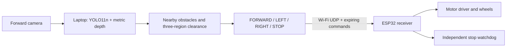

# Laptop vision and ESP32 motor control

The camera is the vehicle's forward view. **The laptop runs perception and
chooses instructions; the ESP32 receives short commands and drives the motors.**
Neither the camera nor the neural network needs to be attached to the ESP32.
For a moving car, rigidly mount the camera on the vehicle and send its live
video to the laptop. A laptop webcam is enough for a handheld presentation.



## Run the visualization now

No board is required. On the prepared development computer:

```powershell
.\run_logic_demo.cmd
```

For a fresh checkout:

```powershell
python -m venv .venv-inference
.venv-inference\Scripts\python -m pip install -r requirements-laptop.txt
.venv-inference\Scripts\python scripts/setup_laptop_models.py
.\run_logic_demo.cmd
```

Setup downloads about 105 MB of model files into ignored `weights/laptop/`.
The script pins the depth revision and verifies both checkpoint hashes. The
viewer reads local files and never downloads substitute models during inference.
The PC requires the PyTorch runtime; the ESP32 requires only its receiver firmware.

```powershell
# Record a visualization from saved footage; no commands go to the car.
.\run_logic_demo.cmd --source path/to/video.mp4 --save-video outputs/demo.mp4
# Set approach/emergency thresholds in estimated meters.
.\run_logic_demo.cmd --avoid-distance 1.5 --stop-distance 0.45
# Explicit alternative backends:
.\run_logic_demo.cmd --detector coco  # Known categories, image proximity only
.\run_logic_demo.cmd --detector esp   # Original tiny bottle/cup/box model
# Group-fine-tuned YOLO11n, with category-independent depth cues:
.\run_logic_demo.cmd --weights weights/laptop/yolo11n-bottle-cup-box.pt --config config/yolo-finetuned.json
```

Use [the demo notebook](../notebooks/laptop_esp32_demo.ipynb) to inspect model
setup, depth, detections, and instructions in stages. The original
[training notebook](../notebooks/train_bottle_cup_box.ipynb) remains available
for the earlier ESPDet experiment. The new [YOLO11 training notebook](../notebooks/train_yolo11.ipynb)
and [fine-tuning report](yolo11-finetuning-report.md) cover the three-class YOLO
alternative. That model names bottle/cup/box only; the original default names
80 COCO categories. Neither model provides universal detection.

## What makes an obstacle?

Default YOLO11n recognizes 80 COCO categories; the fine-tuned alternative names
bottles, cups, and boxes. **Recognized names are optional for
obstacle reasoning:** a separate indoor metric-depth model estimates distance
for image surfaces. Nearby connected surfaces in the decision area can be
labeled `depth obstacle` or `near surface` even if YOLO cannot name them. This
adds a path for boxes, walls, furniture, and unfamiliar shapes to affect the
controller. Detection of any particular object is still not guaranteed.

On a flat course, the program fits a perspective ground plane in inverse depth
to the lower view and removes matching floor pixels. If it cannot establish a
floor, it retains nearby surfaces conservatively instead of inventing empty
space. Reflective/transparent surfaces, thin legs, floors with changing slopes,
camera vibration, occlusion, and poor lighting remain difficult.

Depth components use a geometry acceptance flag internally (`confidence=1`),
not a calibrated neural confidence. The overlay deliberately omits a probability
for those components. Actual object boxes retain their model confidence.

## Distance and steering

Defaults in [the config](../config/default.json) are **initial demo values**:

| Observation in the vehicle's forward decision area | Instruction |
| --- | --- |
| Center objects farther than estimated 1.5 m | FORWARD, after confirmation |
| Center object within estimated 1.5 m; left usable | LEFT |
| Center object within estimated 1.5 m; right usable | RIGHT |
| Both sides usable | Choose the lower occupied-area side; equal scores choose left |
| No usable side | STOP |
| Center object within estimated 0.45 m | STOP immediately |
| Invalid/stale vision, pause, end of input | STOP immediately |

Far detections remain visible but do not contribute to blockage or occupied
area. Overlapping obstacle boxes are unioned so they do not count the same space
twice. Movement requires three matching **processed observations**; a newly
blocked center stops forward movement while a turn is being confirmed. This
is reactive steering, not target following, mapping, or destination navigation.

The visualization and motor commands have **independent freshness limits**.
The viewer retains the last visual instruction while analyzing the next frame,
up to a default five-second frame age, and labels that hold explicitly. It does
not emit alternating FORWARD/STOP merely because normal CPU inference takes
longer than the motor deadline. Camera/inference failure, pause, end of input,
or exceeding the display deadline still stops the preview. Set the bounded
display deadline with `--preview-timeout-ms 5000` (1,000–10,000 ms allowed).

The separate motor controller keeps `stale_after_ms` from the configuration
(default 1,000 ms). Only its decision reaches the Wi-Fi sender. The footer
shows the sent ESP32 command independently of the visual instruction. Recorded
JSONL includes `control_action`, `control_reason`, and, when connected,
`esp_command`. A clear-looking preview never authorizes motors using stale data.

The side regions are image-space approximations, not proof that the car's full
width or turning arc fits. Mark a measured driving corridor after final camera
mounting and test it with the actual chassis dimensions.

The depth model produces learned meter estimates. It is not a measured range
sensor. Compare predictions with tape-measured distances at several positions,
then use `--depth-scale ACTUAL_DISTANCE/PREDICTED_DISTANCE` as an initial scale
correction. One scale factor cannot fix all errors. Check the entire course,
choose speed and thresholds from observed error/latency/stopping distance,
and keep these trials supervised.

With `--detector esp` or `--detector coco`, there is no depth model: the lower box
edge is a camera-specific proximity proxy. Boxes ending above 60% of image
height are considered distant; a center box reaching below 92% with at least
4% of frame area is an emergency. **These percentages are not meters.**

## Connect the ESP32 later

1. Open [visiondrive_receiver.ino](../firmware/visiondrive_receiver/visiondrive_receiver.ino)
   in Arduino IDE with the correct ESP32 board/core installed.
2. Copy [config.example.h](../firmware/visiondrive_receiver/config.example.h) to
   `config.h` beside the sketch. Actual credentials are ignored by Git.
3. Set the Wi-Fi SSID/password and generate a command token:

   ```powershell
   python -c "import secrets; print(secrets.token_hex(16))"
   ```

4. Paste that token into the receiver's `COMMAND_TOKEN`. Leave
   `ENABLE_MOTORS=false` first. Flash, open Serial Monitor at 115200, and note
   the ESP32 IP. Instructions can be inspected before wiring motors.
5. Put both devices on the same local Wi-Fi and run:

   ```powershell
   $env:VISIONDRIVE_ESP_TOKEN = "the_same_32_character_token"
   .\run_logic_demo.cmd --source 0 --esp-host 192.168.1.50
   ```

6. Configure six valid, free GPIOs for your board and compatible two-channel
   PWM/direction motor driver. Wire its standby/enable and power according to
   its datasheet. Enable motor output only after raised-wheel direction checks.
   No pin map is assumed, and this repository has no physical board validation.

The receiver uses a **350 ms default command expiry**, a STOP handshake, a
per-session sequence number, and a Wi-Fi-loss stop. It rejects malformed,
unauthorized, replayed, and out-of-order packets. Expiry requires another STOP
before movement can resume. A bounded packet loop keeps checking the watchdog.
The laptop sends at up to 20 Hz but stops refreshing motion once perception is
stale; it also stops issuing motion if acknowledgements disappear. Pausing or
closing the program sends STOP. UDP delivery is not guaranteed, so the board's
own expiry controls the fail-stop behavior.

Only a live numeric camera input can send commands. Saved videos and simulation
cannot command the board. A lost laptop or inference failure therefore cannot
leave a motion command running indefinitely. Motor stop is zero PWM/coast in
the supplied mapping; braking distance depends on the chosen driver/chassis.

The token filters unintended senders on a trusted local demo network. This UDP
protocol is not encrypted and does not provide cryptographic authentication.
Do not expose its port to the internet. If Windows prompts for network access,
allow the local private network used for the demo.

## What can be claimed to a professor?

> This is a camera-based obstacle-avoidance prototype. A laptop performs
> object detection, depth estimation, and movement decisions; an ESP32 is
> designed to receive expiring commands and control the motors. Detection is
> broader than our initial three-object model. Hardware driving, camera-distance
> calibration, and avoidance accuracy still require course testing.

The original ESPDet model remains an option for future onboard research.
The current YOLO-plus-depth system is **not an onboard ESP32 model**. A camera
connected to an ESP32 could stream to the laptop later; that streaming firmware
is separate from this motor receiver and is not included here.

## Model references

- [Ultralytics YOLO11](https://docs.ultralytics.com/models/yolo11/): pretrained category detector.
- [Depth Anything V2 indoor metric Small](https://huggingface.co/depth-anything/Depth-Anything-V2-Metric-Indoor-Small-hf): learned indoor depth, Apache-2.0.
- [Transformers depth model documentation](https://huggingface.co/docs/transformers/model_doc/depth_anything_v2): metric head and inference.
- [Espressif's COCO model measurements](https://github.com/espressif/esp-dl/blob/master/models/coco_detect/README.md): optional future onboard YOLO path; published upstream timing is not a VisionDrive measurement.
