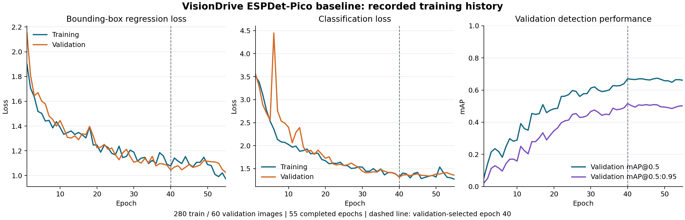

# Dataset Preparation, Model Training, and Evaluation

This section describes the completed three-class ESPDet-Pico experiment in
VisionDrive. It can be adapted to the paper's methodology and results chapters.
The subsequent laptop demonstration uses separate pretrained YOLO11n and depth
models. Results from the two configurations are not interchangeable.

## 1. Dataset source and scope

The project prepared a public-image subset from Open Images for an initial
camera-based object-detection experiment. Source images and existing
bounding-box annotations were selected for Bottle, Coffee cup, and Box and
mapped to the project classes `bottle`, `cup`, and `box`. The group selected,
organized, and converted this data; it did not photograph the source images
or create their original bounding-box annotations [1, P1].

The preparation script used the official Open Images validation bounding-box
CSV served under the `v5` annotation endpoint and the validation image metadata
served under `2018_04`. Images were obtained from the Open Images validation
image collection. The selected source validation pool was subsequently divided
into new **project** training, validation, and testing partitions. Therefore,
the reported evaluation is not an official Open Images benchmark result [P2].

The prepared subset contains **402 images and 688 annotated object instances**.
There are 179 bottle-containing images, 155 cup-containing images, and 68
box-containing images in this subset. Its annotated instances comprise 385
bottles, 189 cups, and 114 boxes. Images and instances are reported separately
because an image may contain more than one annotated object. The source
metadata records CC BY 2.0 license links for the selected images; original
authors, image URLs, source IDs, and hashes are retained in the dataset manifest.


*Figure 1. Actual annotated bottle, cup, and box examples from the project
training, validation, and testing sets. These are source annotations, not model
predictions. Individual image attribution is provided in the
[preview source records](../data/public/preview-sources.json).*

## 2. Annotation preparation and integrity checks

The preparation pipeline retained source annotations with positive source
confidence and excluded annotations marked as depictions or groups. It checked
that normalized bounding-box coordinates were finite and satisfied
`0 <= x_min < x_max <= 1` and `0 <= y_min < y_max <= 1`. Source-confidence flags
are distinct from the model-confidence threshold used during inference [P2].

Each image was assigned a SHA-256 content hash. Duplicate image content was
excluded before split assignment, and the conversion stage rejected duplicate
content across the supplied records. This verifies file-content separation,
but does not establish the absence of near-duplicates, shared scenes, or repeated
physical objects. Image availability, image/label pairing, box geometry, and
source URL/license metadata were checked. A comprehensive manual audit of all
source annotation semantics was not performed [P2].

Annotations were converted to YOLO detection format, with one matching text file
per image. Each line follows:

```text
class_id x_center y_center width height
```

Class IDs are `0 = bottle`, `1 = cup`, and `2 = box`. Given a source box
`(x_min, y_min, x_max, y_max)`, the normalized center is
`((x_min+x_max)/2, (y_min+y_max)/2)`, and its normalized dimensions are
`(x_max-x_min, y_max-y_min)`. Using YOLO annotation format does not imply that
the trained architecture is YOLO11n; the ESPDet pipeline uses the same format.

The prepared structure is:

```text
images/train/    labels/train/
images/val/      labels/val/
images/test/     labels/test/
dataset.yaml
manifest.jsonl
```

The downloadable package preserves original image bytes and includes the
corresponding labels, portable dataset configuration, fixed manifest, source
attribution, and usage instructions. Before packaging, all 402 original image
hashes and decodes, all image/label pairs, and all 688 converted boxes were
verified. These structural checks do not establish that every visually present
obstacle has a complete or semantically correct source annotation [P1].

## 3. Project partitions and unseen situations

Table 1 shows the finalized project partitions. A fixed seed of 42 supported
repeatable selection and splitting. Images were stratified using their target
category, with rarer categories receiving priority for multi-label records,
before approximate 70%/15%/15% partitioning. Integer rounding produced the exact
counts below [P2].

*Table 1. Image and annotated-instance distribution.*

| Project split | Images | Image share | Bottle instances | Cup instances | Box instances |
| --- | ---: | ---: | ---: | ---: | ---: |
| Training | 280 | 69.65% | 294 | 136 | 73 |
| Validation | 60 | 14.93% | 48 | 28 | 15 |
| Testing | 62 | 15.42% | 43 | 25 | 26 |
| Total | 402 | 100.00% | 385 | 189 | 114 |

The training partition supplied images for parameter updates. Validation
supported checkpoint selection and confidence calibration. The selected
detector was then evaluated on the 62 project test images. Test results were
not used to select the checkpoint or inference threshold for the published
baseline experiment [P3, P4].

The distinct content hashes establish that identical image files did not appear
across project partitions. They do not prove scene-disjoint or session-disjoint
evaluation, nor independence from the upstream initialization model's training
data. The test photos were also reused later as integration illustrations;
they must not be described as a new prospective test of the laptop hybrid.

For evaluation on unseen vehicle situations, further data should be collected
at the intended camera height and orientation. Entire recording sessions and
locations should be assigned to one split before frames are extracted. Testing
should reserve new physical object instances and vary lighting, distance, angle,
background, occlusion, and obstacle arrangements. A new test session should be
reserved before tuning thresholds. This is the next evaluation protocol, not
a claim that such recordings have already been collected.

The initial dataset contains target-object images without a dedicated verified
empty-floor negative set. It contains bounding boxes, not depth ground truth,
free-space masks, or steering-command labels. Additional clear-floor examples
and annotation review are needed for a comprehensive obstacle-avoidance dataset.

## 4. ESPDet-Pico model and transfer learning

The baseline used ESPDet-Pico from Espressif's ESP-Detection project, with
224×224 input and **361,365 parameters** in the selected three-class model [2,
P3]. The upstream single-class checkpoint provided transferable initialization.
That checkpoint's original category was cat; it was not used unchanged as the
final bottle/cup/box detector.

The training wrapper rebuilt the architecture from its symbolic configuration,
transferred compatible pretrained weights, and configured the detection head
for three classes. A training-start check verified that the head's class count
matched the dataset. The output classes of the fine-tuned model are bottle,
cup, and box; there is no retained cat output class [P2].

This procedure is transfer learning: compatible learned parameters provide
initialization, while fine-tuning adapts the model to the project's target data.
The project did not train the network from random weights or claim ownership
of the upstream architecture. Upstream source revision, initialization hash,
fine-tuned artifact hash, and license are recorded with the model [P3].

## 5. Training procedure and settings

Training ran on the CPU in a Windows/Python 3.13.5 environment using PyTorch
2.12.0, torchvision 0.27.0, and Ultralytics 8.3.112. The wrapper fixed input
size, batch size, seed, validation behavior, and output location. It disabled
automatic mixed precision and used zero data-loader worker processes [P2, P5].

*Table 2. Recorded settings for the completed training run.*

| Setting | Recorded value |
| --- | --- |
| Model / output classes | ESPDet-Pico / bottle, cup, box |
| Input size | 224×224 |
| Training / validation images | 280 / 60 |
| Epoch budget / completed | 60 / 55 |
| Validation-selected checkpoint | Epoch 40 |
| Batch size | 16 |
| Random seed | 42 |
| Device / CPU threads | CPU / 2 |
| Data-loader workers | 0 |
| Optimizer request / resolved optimizer | Automatic / AdamW |
| Initial learning rate printed by optimizer log | Approximately 0.001429 |
| Momentum printed by optimizer log | 0.9 |
| Weight decay setting | 0.0005, applied by parameter group |
| Early-stopping patience | 15 epochs |
| Mixed precision | Disabled |
| Recorded training duration | About 695.7 s, or 11.6 min |

The optimizer was selected automatically. Its effective logged learning rate
should not be confused with the nominal `lr0=0.01` present in the argument
dump: the trainer explicitly reported overriding that nominal value and
momentum when selecting AdamW. The learning-rate schedule also changed rates
over training. A portable summary is provided in the
[recorded configuration](baseline-training-configuration.json).

Training-time augmentation included horizontal flipping, translation, scale
variation, HSV color variation, and mosaic. Recorded settings included
horizontal-flip probability 0.5, translation 0.1, scale 0.5, HSV hue 0.015,
saturation 0.7, value 0.4, and mosaic probability 1.0. Mosaic was configured to
close for the final ten scheduled epochs. These operations altered training
inputs and their boxes together; they did not increase the number of independent
stored images or move examples between partitions [P2, P5].

The model optimized object classification and bounding-box regression. Validation
was performed during training. In the pinned trainer, the checkpoint selection
fitness weighted validation mAP@0.5 by 0.1 and mAP@0.5:0.95 by 0.9. The best
checkpoint occurred at epoch 40. After 15 subsequent epochs without improvement
in the selection score, early stopping ended the run at epoch 55. This differs
from a claim that 60 epochs were completed or that the final epoch was selected.



*Figure 2. Training and validation box/classification loss, and validation mAP,
generated from the 55 recorded epochs in the training CSV. The dashed line
marks the validation-selected epoch 40. These are validation curves, not the
held-out test results. They do not by themselves establish generalization [P5].*

## 6. Confidence calibration and evaluation protocol

Following checkpoint selection, the evaluator generated predictions and compared
confidence thresholds `0.15, 0.20, 0.25, 0.30, 0.35, 0.40, 0.50` on validation
images. Predictions were initially collected at confidence 0.05, with NMS IoU
0.45. The selected operating threshold was **0.35**, maximizing validation macro
F1, with a higher threshold used as the tie-breaker. Macro F1 gives each class
equal weight in this threshold-selection calculation [P4].

For fixed-threshold precision, recall, and F1, predictions were considered in
descending confidence order and matched one-to-one with ground-truth boxes
of the same class at **IoU ≥ 0.5**. Each target could match at most one prediction.
Unmatched predictions counted as false positives; unmatched annotated targets
counted as false negatives. IoU is the intersection area of two boxes divided
by their union area.

The reported metrics follow:

```text
Precision = TP / (TP + FP)
Recall    = TP / (TP + FN)
F1        = 2TP / (2TP + FP + FN)
```

The native model validator separately supplied mAP@0.5 and mAP@0.5:0.95.
These summarize average precision across confidence levels; the latter also
averages the IoU thresholds 0.50 through 0.95 in 0.05 increments. They should
not be described as fixed-confidence accuracy or physical driving success.

## 7. Baseline test results and interpretation

The selected baseline achieved **mAP@0.5 = 0.4687** and
**mAP@0.5:0.95 = 0.3574** on the 62 project test images [P3, P4].

*Table 3. Test-set results at confidence 0.35, IoU ≥ 0.5, class-aware one-to-one matching.*

| Class | TP | FP | FN | Precision | Recall | F1 |
| --- | ---: | ---: | ---: | ---: | ---: | ---: |
| Bottle | 19 | 15 | 24 | 0.559 | 0.442 | 0.494 |
| Cup | 19 | 6 | 6 | 0.760 | 0.760 | 0.760 |
| Box | 4 | 14 | 22 | 0.222 | 0.154 | 0.182 |

Cups had the highest fixed-threshold F1 in this run. Bottle misses remained
substantial, and only four of the 26 annotated test boxes were matched for the
box class. The weak box recall prevents treating the baseline as a reliable
general obstacle detector. Class imbalance, limited examples, annotation
quality, and camera-domain differences are plausible contributors, but their
individual effects were not isolated through controlled experiments.

The results evaluate the annotated target classes under this protocol. They do
not measure every possible obstacle, calibrated distance, drivable space, or
collision avoidance. No physical vehicle success rate is available.

## 8. Relationship to the current laptop demonstration

The current demonstration loads pretrained YOLO11n for 80 common COCO categories
and Depth Anything V2 Metric Indoor Small for estimated depth and nearby-surface
cues [3–5]. The project has not fine-tuned either of these models on the
402-image baseline dataset. Their upstream pretraining data and objectives are
separate from the project's ESPDet experiment.

Movement instructions are computed by programmed region/proximity rules rather
than learned from steering labels. The laptop runs perception and decisions;
an optional ESP32 receiver handles expiring motor commands. Camera-course
evaluation, distance calibration, board operation, and physical driving remain
unvalidated. The baseline's numeric results must not be assigned to this hybrid.

## 9. Reproducibility and available materials

- [Public dataset preview and download](https://github.com/thebaynal/Vision-Drive/blob/main/data/public/README.md#preview-and-download)
- [Fixed dataset release](https://github.com/thebaynal/Vision-Drive/releases/tag/dataset-v1.0.0)
- [Dataset manifest](../data/public/bottle-cup-box-manifest.jsonl) and [dataset card](../data/public/README.md)
- [Original training notebook](../notebooks/train_bottle_cup_box.ipynb)
- [Recorded training configuration](baseline-training-configuration.json), [training history](training-results.csv), and [baseline report](model-report.md)
- [Evaluation JSON](model-evaluation.json) and [model artifact provenance](../weights/obstacle/model.json)
- [Current laptop walkthrough](../notebooks/laptop_esp32_demo.ipynb) and [verification report](verification.md)

Reproduction should preserve the fixed source hashes, labels, and partitions.
A fixed seed improves repeatability but does not guarantee identical results
across all software versions, processors, or numerical backends. New data,
model changes, and threshold tuning require a separate prospective test set.

## References and project evidence

**[1]** Open Images. [Downloads and dataset documentation](https://storage.googleapis.com/openimages/web/download_v7.html).
The implementation's exact annotation/metadata source endpoints are recorded in [P2].

**[2]** Espressif. [ESP-Detection](https://github.com/espressif/esp-detection),
project-pinned revision `28de5902a357d99dd9a5db0f52905255641c5a78`.

**[3]** Ultralytics. [YOLO11 documentation](https://docs.ultralytics.com/models/yolo11/).

**[4]** Yang et al. [Depth Anything V2](https://arxiv.org/abs/2406.09414), 2024.

**[5]** Depth Anything. [Depth Anything V2 Metric Indoor Small model card](https://huggingface.co/depth-anything/Depth-Anything-V2-Metric-Indoor-Small-hf).

**[P1]** VisionDrive. [Dataset card](../data/public/README.md),
[fixed manifest](../data/public/bottle-cup-box-manifest.jsonl), and
[preview attribution](../data/public/preview-sources.json).

**[P2]** VisionDrive implementation:
[source selection/splitting](../scripts/build_object_dataset.py),
[annotation conversion](../scripts/prepare_dataset.py), and
[training wrapper](../scripts/train_model.py).

**[P3]** VisionDrive. [Baseline model report](model-report.md) and
[model provenance](../weights/obstacle/model.json), recorded 2026-10-16.

**[P4]** VisionDrive. [Evaluation report](model-evaluation.json) and
[evaluation implementation](../scripts/evaluate_objects.py).

**[P5]** VisionDrive. [Recorded configuration](baseline-training-configuration.json)
and [55-epoch training history](training-results.csv).
